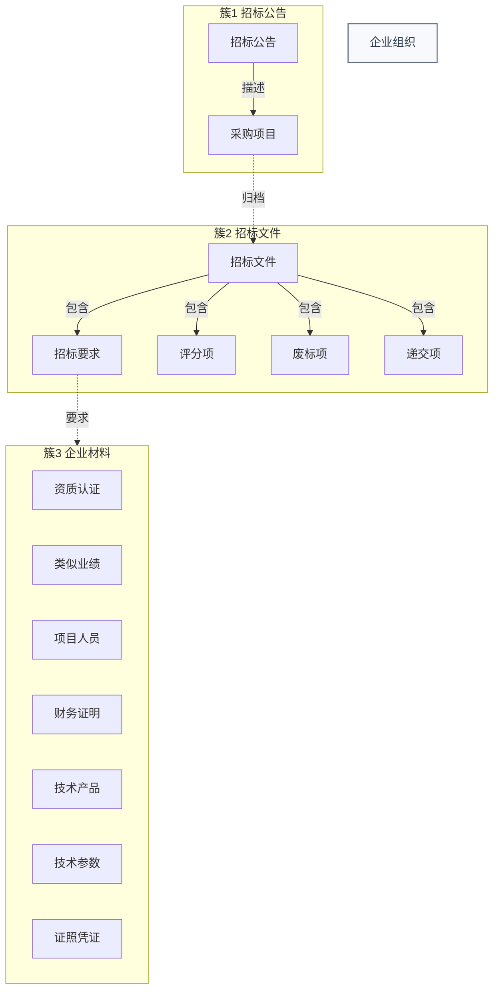

# 投标智能体本体——总览与命名空间

**版本**：V0.4（证据文件夹化）
**设计日期**：2026-09-07
**适用范围**：招标公告、招标文件、企业材料三大本体的**内容拆解**（每个对象内部有什么、指向什么）
**明确不包含**：标书模板、响应文件生成、Word 排版、报价文件、合同履约闭环；采集/初筛/匹配/提醒等**系统流程对象**（另行建模）
**建议命名空间**：`tenderhub`

> **V0.4**（企业材料簇）：**8 类 + 8 关系**。证据溯源改为 `evidencePath`（事实直接挂证据文件夹路径），删除 `EnterpriseMaterial` 类与 `materialId` 外键（9 类 → 8 类、16 关系 → 8 关系）（详见 03）。

---

## 一、拆分结论

本版本把投标智能体本体拆成**同一命名空间下的三个簇**，共享主体与公共类，各自独立演进：

```text
/tenderhub （单一命名空间）
├── 簇 1　招标公告簇  —— 拆解"一条公告内部有什么"：采购项目、资格要求、获取/提交/开启安排、采购人、代理机构
├── 簇 2　招标文件簇  —— 拆解"一份文件内部有什么"：招标要求、评分项、废标项，及要求指向的匹配对象
└── 簇 3　企业材料簇  —— 拆解"企业有什么"：业务、资质、技术产品，及材料归档
```

三簇之间**不建立跨簇的双向业务关系**，只通过**共享类引用 + 业务编号（projectCode / companyCode / materialCode）**衔接。

| 簇 | 核心锚点类 | 拆解内容 | 主要输入 |
|:---|:---|:---|:---|
| 招标公告簇 | `TenderAnnouncement`、`TenderProject` | 采购项目、资格要求、获取/提交/开启安排、采购人、代理机构 | 公开网站公告 |
| 招标文件簇 | `TenderDocument`、`TenderRequirement` | 招标要求、评分项、废标项、递交项 + 要求指向的匹配对象 | 招标/磋商/澄清文件 |
| 企业材料簇 | `Organization`、`Credential` | 资质、业绩、人员、财务、技术产品、技术参数、证照凭证 | 企业上传的资质/业绩/产品/方案文件 |

---

## 二、命名空间与命名规范

### 2.1 命名空间

```text
命名空间：/tenderhub
含义：tender 招标业务 + hub 数据枢纽（项目名，与 data-query 端 loginCode=tenderhub 一致）
```

正式导入前须确认该命名空间未被占用；若被占用，改尾号重新生成，不覆盖已有数据。

### 2.2 命名规范（全局强制）

| 元素 | 规范 | 示例 |
|:---|:---|:---|
| 类名 | PascalCase | `TenderAnnouncement` |
| 属性名 | camelCase | `publishAt`、`budgetAmount` |
| 关系名 | snake_case 动词 | `publishes`、`describes_project` |
| 类路径 | `/tenderhub/{snake_case}` | `/tenderhub/tender_announcement` |
| nickname | `tenderhub_{snake_case}` | `tenderhub_tender_announcement` |
| 对象 RID | `{nickname}:{业务编号}` | `tenderhub_tender_announcement:ANN_0001` |

### 2.3 M3 技术约束（全局强制）

1. **不支持类继承**：所有"子类型"用类型属性（`xxxType`）区分，不建父类/子类。
2. **不建双向关系**：只保留单向 Edge，反向查询用入边完成。
3. **状态与类型分离**：瞬时状态（有效/失效/待解析）作为属性；有独立身份、需追溯的对象才建类。
4. **时间作为属性**：不把时间建成独立对象类。
5. **集合类型保守**：关键词、地区、行业等多值字段第一版用 `text`（可检索、逗号/顿号分隔）保存；`set<varchar>` 待生成器验证后再用。
6. **编号按文本保存**：`projectNo`、`announcementNo` 等一律 `varchar`，不转数字。
7. **保留字规避**：`Order`、`Group`、`From`、`To` 等 M3 保留字不直接用作类名/属性名。

---

## 三、共享类（三簇共同引用）

以下类在三个簇中都会被引用，**只定义一次、权威归属唯一**，其它簇通过关系或引用访问，不复制属性。

### 3.1 `Organization` 企业组织

采购人、招标代理机构、投标供应商统一用本类表达，用 `organizationType` 区分角色。

| 属性 | 类型 | 说明 |
|:---|:---|:---|
| organizationId | varchar | 主键，企业唯一标识 |
| organizationName | varchar | 企业名称 |
| organizationType | varchar | 角色：purchaser 采购人 / agency 代理机构 / bidder 投标供应商 |
| unifiedSocialCreditCode | varchar | 统一社会信用代码 |
| legalRepresentative | varchar | 法定代表人 |
| registeredAddress | text | 注册地址 |
| contactInfo | varchar | 联系方式 |
| employeeCount | int | 从业人员数 |
| annualRevenueWan | double | 营业收入（万元） |
| totalAssetsWan | double | 资产总额（万元） |
| enterpriseSize | varchar | 企业规模类型：中型企业 / 小型企业 / 微型企业 |
| description | text | 企业描述（LLM 归纳） |
| serviceRegions | text | 服务地区（可检索文本，逗号分隔） |
| serviceIndustries | text | 服务行业（可检索文本，逗号分隔） |
| capabilities | text | 能力清单（LLM 归纳，逗号分隔） |
| status | varchar | 状态：active / inactive |

> 采购人/代理机构是"项目对手方"信息，投标供应商是"我方主体"。三者不拆成三个类（属性重叠 >70%），用 `organizationType` 区分（原则 2、M3 不支持继承）。

### 3.2 （已删除）`MaterialCategory` 具体材料类

> 已删除。V0.4 起证据溯源改为 `evidencePath`（事实直接挂证据文件夹路径），不再有材料注册表类与 `materialId` 外键。

---

## 四、三簇关系总图



> 实线为簇内拆解关系，虚线为跨簇主衔接：项目归档文件、要求指向企业材料。三簇各自的完整拆解见 01/02/03。

---

## 五、跨簇衔接约定

| 衔接点 | 承载方式 | 说明 |
|:---|:---|:---|
| 公告 → 项目 | 簇 1 `TenderAnnouncement → describes_project → TenderProject` | 公告描述采购项目 |
| 项目 → 文件 | 簇 2 `TenderProject → has_document → TenderDocument` | 项目归档招标文件 |
| 要求 → 资质 | 簇 2 `TenderRequirement → requires_qualification → QualificationCertificate` | 要求指向资质证书 |
| 要求 → 产品 | 簇 2 `TenderRequirement → requires_product → TechnicalProduct` | 要求指向产品或服务 |
| 要求 → 业绩 | 簇 2 `TenderRequirement → requires_performance → PerformanceCase` | 要求指向项目业绩 |
| 要求 → 人员 | 簇 2 `TenderRequirement → requires_staff → StaffMember` | 要求指向项目人员 |
| 要求 → 证照凭证 | 簇 2 `TenderRequirement → requires_credential → Credential` | 要求指向认证/知识产权 |

跨簇只保留**业务主路径**上的强关系；可由主路径推导的辅助关系一律不建。

---

## 六、全局受控词表（全局共享）

| 词表 | 取值 |
|:---|:---|
| organizationType | purchaser / agency / bidder |
| procurementMethod | 公开招标 / 邀请招标 / 竞争性磋商 / 竞争性谈判 / 询价 / 单一来源 / 框架协议 |
| announcementType | 招标公告 / 资格预审公告 / 更正公告 / 答疑澄清 / 结果公告 / 其他 |
| documentType | 招标文件 / 磋商文件 / 澄清文件 / 补遗文件 / 变更文件 |
| mandatoryLevel | hard 硬性门槛 / material 实质性条款 / score 评分项 / reference 一般说明 |
| verificationStatus | 未核验 / 已核验有效 / 已核验过期 / 待人工确认 |
| documentStatus | 待解析 / 解析中 / 解析完成 / 解析失败 / 已归档 |

---

## 七、建模原则（简引，完整见 uino-02-ontology-modeling）

1. **业务实体优先**：多表同实体合并、一表多实体拆分；不镜像建表。
2. **奥卡姆剃刀**：能用类型属性区分就不建继承/子类；大概念→类，小概念/枚举/特征→属性。
3. **类命名五原则**：真实业务对象、区分对象/属性/状态/角色、事实记录显式建模、划清边界、为关系与问题服务。
4. **关系命名十三原则**：只做谓语、方向顺语义、动词成句、一个动词一种含义、不建双向、分类走类层级。
5. **强语义关系 + 合理路径**：只建强语义关系，核心路径 ≤3 跳（优化目标）、可接受 4-5 跳。
6. **属性归并**：码表/枚举值内嵌为属性。
7. **字段全量映射**：源字段必须映射，不随意剔除。
8. **语义归属唯一**：每个属性只有一个权威归属类。

---

## 八、文档组织

| 文件 | 内容 |
|:---|:---|
| `00_总览与命名空间.md` | 本文件：命名空间、共享类、跨簇衔接、全局词表 |
| `01_招标公告本体.md` | 簇 1 拆解图 + 类/属性/关系/受控词表/查询路径 |
| `02_招标文件本体.md` | 簇 2 拆解图 + 类/属性/关系/受控词表/查询路径 |
| `03_企业材料本体.md` | 簇 3 拆解图 + 类/属性/关系/受控词表/查询路径（含业务/资质/技术产品三个子簇） |
