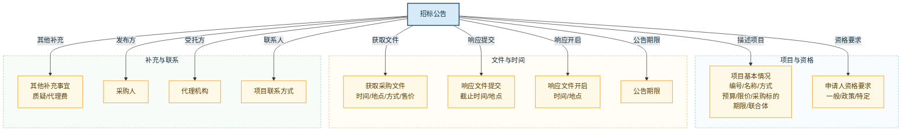

# 簇 1　招标公告本体设计

**版本**：V0.4
**命名空间**：`/tenderhub`
**簇定位**：一条招标公告内部拆解出什么——公告元信息、采购项目（预算/限价/采购标的/期限/联合体）、申请人资格要求（一般/政策/特定）、获取文件/提交/开启安排（含时间）、公告期限、代理费、采购人、代理机构、项目联系方式
**参考样例**：ccgp 山西分网《临猗县猗氏镇贵戚坊小学餐厅劳务派遣服务项目竞争性磋商公告》（项目编号 1408212026CCS00087）

> 本簇只表达「公告内部有什么」。采集来源、抓取规则、初筛评分、企业微信提醒等属于**系统流程层**，不在本拆解本体中建模。
> 属性少的简单内容（时间节点、采购标的）不单独建类，作为属性归入 `TenderAnnouncement` / `TenderProject`。

---

## 一、拆解结构图



> 一层拆解：招标公告直接辐射出各栏目。采购标的已并入「项目基本情况」，时间节点已并入「获取文件/提交/开启」各栏目，不再单列。

---

## 二、对象类设计

### 2.1 `TenderAnnouncement` 招标公告（根）

**公告元信息**

| 属性 | 类型 | 说明 |
|:---|:---|:---|
| announcementId | varchar | 主键 |
| announcementNo | varchar | 公告编号（部分公告无独立编号，可为空，用 sourceUrl/dedupHash 识别） |
| title | text | 公告标题 |
| announcementType | varchar | 公告类型：招标公告 / 资格预审公告 / 更正公告 / 结果公告 … |
| publishAt | timestamp | 发布时间 |
| sourceSiteName | varchar | 来源站点名称（如"中国政府采购网山西分网"） |
| sourceUrl | varchar | 原始链接 |
| region | varchar | 地区（省/市/县） |
| contentSummary | text | 项目概况引导语摘要 |
| rawContent | text | 公告原文（检索匹配用） |
| hasDocumentLink | boolean | 是否有招标文件下载链接 |
| dedupHash | varchar | 去重键（url 或正文 md5） |
| status | varchar | 状态：new / deduplicated / merged / ignored |

**申请人资格要求（三段）**

| 属性 | 类型 | 说明 |
|:---|:---|:---|
| generalQualification | text | 一般资格要求（如"满足政府采购法第二十二条"） |
| policyQualification | text | 落实政府采购政策的资格要求（如"专门面向中小企业"） |
| specificQualification | text | 本项目的特定资格要求（如"具备《劳务派遣经营许可证》""信用记录""控股关系"） |

**获取文件 / 提交 / 开启安排（含时间节点）**

| 属性 | 类型 | 说明 |
|:---|:---|:---|
| obtainDocStartAt | timestamp | 获取文件开始时间 |
| obtainDocEndAt | timestamp | 获取文件截止时间 |
| obtainDocPlace | varchar | 获取采购文件地点 |
| obtainDocMethod | varchar | 获取方式：在线 / 现场 / 邮寄 / 邮箱 |
| obtainDocPrice | varchar | 文件售价（"0"或"XX元"） |
| submitDeadlineAt | timestamp | 响应文件提交截止时间 |
| submitPlace | varchar | 响应文件提交地点 |
| openingAt | timestamp | 响应文件开启时间 |
| openingPlace | varchar | 开启地点 |

**公告期限 / 代理费 / 联系方式**

| 属性 | 类型 | 说明 |
|:---|:---|:---|
| announcementPeriodDays | int | 公告期限（工作日） |
| otherMatters | text | 其他补充事宜（质疑要求等） |
| agencyFeePayment | varchar | 代理费支付方式（供应商支付 / 采购人支付） |
| agencyFeeStandard | varchar | 代理费收费标准 |
| agencyFeeAmount | double | 代理费收费金额（元，可为空） |
| projectContactName | varchar | 项目联系人 |
| projectContactPhone | varchar | 项目联系电话 |

> **与招标文件边界**：`specificQualification` 里"具备《劳务派遣经营许可证》"等逐条资质要求，在招标文件中会展开成逐条 `TenderRequirement`（qualification 类型）并关联企业资质做匹配；公告阶段以文本概要承载。

### 2.2 `TenderProject` 采购项目

**项目基本信息**

| 属性 | 类型 | 说明 |
|:---|:---|:---|
| projectId | varchar | 主键 |
| projectNo | varchar | 项目编号（如 1408212026CCS00087，稳定聚合键） |
| projectName | text | 项目名称 |
| projectType | varchar | 项目类型：货物 / 服务 / 工程 |
| procurementMethod | varchar | 采购方式 |
| budgetAmount | double | 预算金额（元） |
| maxPrice | double | 最高限价（元，如有） |
| currency | varchar | 币种 |
| contractPeriod | varchar | 合同履约期限（如"一学年"） |
| acceptJointVenture | boolean | 是否接受联合体投标 |

**采购标的（并入，单标项为属性）**

| 属性 | 类型 | 说明 |
|:---|:---|:---|
| itemName | text | 标项名称 |
| itemQuantity | double | 数量（劳务/服务类常为空） |
| itemUnit | varchar | 单位（套 / 人 / 项，可为空） |
| itemSpecification | text | 简要规格描述 |
| itemEstimatedAmount | double | 标项预算金额（元） |
| itemRemark | text | 备注 |

**组织与状态**

| 属性 | 类型 | 说明 |
|:---|:---|:---|
| purchaserName | varchar | 采购人名称 |
| agencyName | varchar | 代理机构名称 |
| region | varchar | 地区 |
| industryTags | text | 行业标签（逗号分隔） |
| projectStatus | varchar | 状态：monitoring / qualified / discarded / bid_submitted |
| createdAt | timestamp | 创建时间 |

> 采购标的并入项目为属性（第一版多为单标项）；若出现多标段项目，再单独拆 `ProcurementItem` 类。
> `Organization`（采购人/代理机构）为共享类，定义见 `00_总览与命名空间.md`。

---

## 三、关系设计

| 关系名 | 从类 | 到类 | 中文语义 | 强度 |
|:---|:---|:---|:---|:---:|
| `describes_project` | TenderAnnouncement | TenderProject | 公告描述采购项目 | 强 |
| `publishes` | Organization | TenderAnnouncement | 采购人发布公告 | 强 |
| `acts_for` | Organization | TenderAnnouncement | 代理机构受托代理公告 | 强 |

---

## 四、公告栏目 → 对象/属性 全量映射（对照本公告）

| 公告栏目 | 归入对象 | 对应属性 | 本公告示例 |
|:---|:---|:---|:---|
| 标题 | TenderAnnouncement | title | 临猗县猗氏镇中心学校竞争性磋商…餐厅劳务派遣服务项目 |
| 发布时间 | TenderAnnouncement | publishAt | 2026-08-31 18:30 |
| 来源 | TenderAnnouncement | sourceSiteName | 中国政府采购网山西分网 |
| 项目概况（引导语） | TenderAnnouncement | contentSummary | …在政采云平台线上获取… |
| 项目编号 | TenderProject | projectNo | 1408212026CCS00087 |
| 项目名称 | TenderProject | projectName | 临猗县猗氏镇贵戚坊小学餐厅劳务派遣服务项目 |
| 采购方式 | TenderProject | procurementMethod | 竞争性磋商 |
| 预算金额 | TenderProject | budgetAmount | 410000 |
| 最高限价 | TenderProject | maxPrice | 365000 |
| 标项名称 | TenderProject | itemName | 临猗县猗氏镇贵戚坊小学餐厅劳务派遣服务项目 |
| 数量 / 单位 | TenderProject | itemQuantity / itemUnit | 空 |
| 简要规格描述 | TenderProject | itemSpecification | 临猗县猗氏镇贵戚坊小学餐厅劳务派遣服务 |
| 标项预算金额 | TenderProject | itemEstimatedAmount | 410000 |
| 合同履约期限 | TenderProject | contractPeriod | 一学年 |
| 是否接受联合体 | TenderProject | acceptJointVenture | 否 |
| 一般资格要求 | TenderAnnouncement | generalQualification | 满足政府采购法第二十二条 |
| 政策资格要求 | TenderAnnouncement | policyQualification | 专门面向中小企业 |
| 特定资格要求 | TenderAnnouncement | specificQualification | 具备《劳务派遣经营许可证》… |
| 获取文件开始/截止 | TenderAnnouncement | obtainDocStartAt / obtainDocEndAt | 2026-08-31 至 09-07 |
| 获取文件地点 | TenderAnnouncement | obtainDocPlace | 政采云平台线上获取 |
| 获取文件方式 | TenderAnnouncement | obtainDocMethod | 在线获取 |
| 售价 | TenderAnnouncement | obtainDocPrice | 0 |
| 响应提交截止 | TenderAnnouncement | submitDeadlineAt | 2026-09-11 09:00 |
| 响应提交地点 | TenderAnnouncement | submitPlace | 政采云投标客户端 |
| 开启时间 | TenderAnnouncement | openingAt | 2026-09-11 09:00 |
| 开启地点 | TenderAnnouncement | openingPlace | 盐湖区禹都花园…开标室1 |
| 公告期限 | TenderAnnouncement | announcementPeriodDays | 3 个工作日 |
| 其他补充事宜 | TenderAnnouncement | otherMatters | 质疑一次性提出 |
| 代理费支付方式 | TenderAnnouncement | agencyFeePayment | 供应商支付 |
| 代理费收费标准 | TenderAnnouncement | agencyFeeStandard | 发改价格【2011】534号文 50% |
| 采购人信息 | Organization | organizationName / registeredAddress / contactInfo | 临猗县猗氏镇中心学校 / 南环西路689号 / 13835993126 |
| 代理机构信息 | Organization | organizationName / registeredAddress / contactInfo | 山西裕昌工程项目管理有限公司 |
| 项目联系方式 | TenderAnnouncement | projectContactName / projectContactPhone | 武先生 / 13303402412 |

---

## 五、受控词表（簇 1 专属）

| 词表 | 取值 |
|:---|:---|
| announcementType | 招标公告 / 资格预审公告 / 更正公告 / 答疑澄清 / 结果公告 / 其他 |
| procurementMethod | 公开招标 / 邀请招标 / 竞争性磋商 / 竞争性谈判 / 询价 / 单一来源 / 框架协议 |
| projectType | 货物 / 服务 / 工程 |
| obtainDocMethod | 在线 / 现场 / 邮寄 / 邮箱 / 其他 |
| agencyFeePayment | 供应商支付 / 采购人支付 |
| projectStatus | monitoring / qualified / discarded / bid_submitted |

---

## 六、典型查询路径

### 6.1 某项目采购什么、预算与限价、期限

```text
TenderAnnouncement → describes_project → TenderProject
读取 TenderProject.budgetAmount / maxPrice / itemName / itemSpecification / contractPeriod / acceptJointVenture
```

### 6.2 某公告的完整时间线

```text
TenderAnnouncement.obtainDocStartAt / obtainDocEndAt / submitDeadlineAt / openingAt
按时间排序：获取文件开始 → 获取文件截止 → 提交截止 → 开启
```

### 6.3 某公告的资格要求（含特定资质）

```text
TenderAnnouncement.generalQualification / policyQualification / specificQualification
特定资格里的资质要求 → 后续进招标文件簇 TenderRequirement(qualification) 做资质匹配
```

### 6.4 某公告的获取文件方式与提交/开启地点

```text
TenderAnnouncement.obtainDocPlace / obtainDocMethod / obtainDocPrice / submitPlace / openingPlace
```

### 6.5 采购人、代理机构、项目联系人

```text
Organization → publishes → TenderAnnouncement（采购人）
Organization → acts_for → TenderAnnouncement（代理机构）
TenderAnnouncement.projectContactName / projectContactPhone
```

---

## 七、簇内质量自检

- [x] 覆盖公告全部栏目（对照 ccgp 山西分网样例）。
- [x] 属性少的简单内容（时间节点、采购标的）不建类，作为属性归入公告/项目。
- [x] 时间作为属性，不建独立时间对象类。
- [x] 只拆解公告内部，不画采集/初筛/提醒流程。
- [x] 资格要求按「一般/政策/特定」三段拆属性。
- [x] 采购人/代理机构用 `Organization` 角色实例，不建两个类。
- [x] 无双向关系、无继承。
