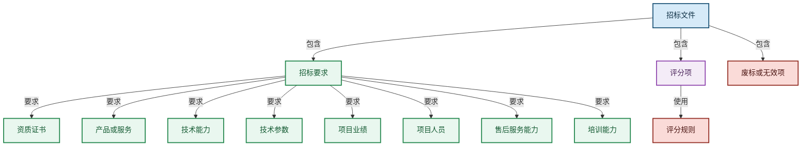

# 簇 2　招标文件本体设计

**版本**：V0.1
**命名空间**：`/tenderhub`
**簇定位**：一份招标文件内部拆解出什么——招标要求、评分项、废标或无效项，以及招标要求指向哪些匹配对象
**参考数据**：《【招标文件】济南新视中…公开招标文件》、《数据中心行业共同体项目…（发布稿）(采购人).docx》、《【脱敏】贵州电子-响应文件》评标索引

> 本簇只表达「招标文件内部有什么、要求指向什么」。文件下载/上传、逐项匹配评估、证据记录等属于**系统流程层**，不在本拆解本体中建模。

---

## 一、拆解结构图



> **读法**：招标文件 = 招标要求 + 评分项 + 废标或无效项；评分项使用评分规则；招标要求分别指向企业需具备的资质证书、产品或服务、技术能力、技术参数、项目业绩、项目人员、售后服务能力、培训能力（这些指向企业材料簇的类）。

---

## 二、对象类设计

### 2.1 `TenderDocument` 招标文件

工作人员获取并上传的采购/磋商/澄清文件，是招标文件本体的根。

| 属性 | 类型 | 说明 |
|:---|:---|:---|
| documentId | varchar | 主键 |
| documentType | varchar | 类型：招标文件 / 磋商文件 / 澄清文件 / 补遗文件 |
| documentName | text | 文件名 |
| versionNo | varchar | 版本号 |
| issuedAt | timestamp | 发出时间 |
| fileRef | varchar | 文件存储引用 |
| fileHash | varchar | 内容哈希 |
| pageCount | int | 页数 |
| parseStatus | varchar | 解析状态：待解析 / 解析中 / 解析完成 / 解析失败 |
| isCurrent | boolean | 是否当前生效版本 |

### 2.2 `TenderRequirement` 招标要求

招标文件中一条**可独立检查、匹配和追溯**的要求。

| 属性 | 类型 | 说明 |
|:---|:---|:---|
| requirementId | varchar | 主键 |
| requirementNo | varchar | 要求编号 |
| requirementType | varchar | 类型：qualification 资格 / business 商务 / technical 技术 / delivery 交付 / finance 财务 / personnel 人员 |
| title | text | 要求标题 |
| content | text | 要求正文 |
| mandatoryLevel | varchar | 硬性程度：hard 硬性门槛 / material 实质性条款 / score 评分项 / reference 一般说明 |
| isHardBlock | boolean | 是否硬性阻断 |
| operator | varchar | 比较符（可量化要求）：ge / le / eq / between |
| thresholdValue | double | 阈值（如"≥500 万"的 5000000） |
| thresholdUnit | varchar | 单位（元 / 人 / 年 / 项） |
| requiredEvidence | text | 要求提供的证明材料 |
| sourcePage | varchar | 来源页码 |
| sourceQuote | text | 原文摘录 |
| extractionConfidence | double | 抽取置信度 |

> 要求类型是 `requirementType` 的受控值，不建资格/商务/技术继承子类（M3 不支持继承）。

### 2.3 `EvaluationCriterion` 评审评分项

评标时用于给响应文件打分的一项评分因素。

| 属性 | 类型 | 说明 |
|:---|:---|:---|
| criterionId | varchar | 主键 |
| criterionNo | varchar | 评分项编号 |
| criterionName | text | 评分项名称 |
| criterionType | varchar | 类型：price 报价 / technical 技术 / business 商务 / performance 业绩 / service 服务 |
| maxScore | double | 满分值 |
| weight | double | 权重 |
| scoringRule | text | 评分规则（评分项的核心属性） |
| requiredEvidence | text | 评分所需证据 |
| sourcePage | varchar | 来源页码 |
| extractionConfidence | double | 抽取置信度 |

> 图中的「评分规则」是 `EvaluationCriterion.scoringRule` 属性，独立展示以强调其关键性；不单独建「评分规则」类（规则是一段评分文本，无独立生命周期）。

### 2.4 `DisqualificationRule` 废标或无效项

触发废标、无效投标、终止评审或不参与评分的条件。

| 属性 | 类型 | 说明 |
|:---|:---|:---|
| ruleId | varchar | 主键 |
| ruleNo | varchar | 规则编号 |
| ruleType | varchar | 类型：格式 / 签章 / 证明缺失 / 实质不响应 / 报价异常 / 其他 |
| triggerCondition | text | 触发条件 |
| severity | varchar | 严重程度：hardStop 否决 / warning 警告 |
| isHardStop | boolean | 是否一票否决 |
| checkMethod | text | 校验方法 |
| sourcePage | varchar | 来源页码 |
| extractionConfidence | double | 抽取置信度 |

### 2.5 `SubmissionItem` 响应文件要求项

招标文件规定响应文件必须出现的章节、表格、声明、证明材料或签章项。

| 属性 | 类型 | 说明 |
|:---|:---|:---|
| submissionItemId | varchar | 主键 |
| itemNo | varchar | 项编号 |
| itemName | text | 项名称 |
| itemType | varchar | 类型：章节 / 表格 / 声明 / 证明 / 签章 |
| required | boolean | 是否必填 |
| signatureRequired | boolean | 是否需签字 |
| sealRequired | boolean | 是否需盖章 |
| formatRequirement | text | 格式要求 |
| copyRequirement | varchar | 份数要求（正本/副本/电子） |
| orderNo | int | 顺序 |
| sourcePage | varchar | 来源页码 |

> 采购标的、时间节点在簇 1 已作为属性并入 `TenderProject`（`itemName`/`itemSpecification`/`itemEstimatedAmount` 等）与 `TenderAnnouncement`（`obtainDocStartAt`/`submitDeadlineAt`/`openingAt` 等）；招标文件通过 `has_document` 关联项目/公告获取，不重复定义。

---

## 三、关系设计

| 关系名 | 从类 | 到类 | 中文语义 | 强度 |
|:---|:---|:---|:---|:---:|
| `has_document` | TenderProject | TenderDocument | 采购项目归档招标文件 | 强 |
| `contains_requirement` | TenderDocument | TenderRequirement | 文件包含招标要求 | 强 |
| `contains_criterion` | TenderDocument | EvaluationCriterion | 文件包含评分项 | 强 |
| `contains_disqualification` | TenderDocument | DisqualificationRule | 文件包含废标项 | 强 |
| `contains_submission_item` | TenderDocument | SubmissionItem | 文件规定递交项 | 强 |
| `requires_qualification` | TenderRequirement | QualificationCertificate | 要求指向资质证书 | 强 |
| `requires_product` | TenderRequirement | TechnicalProduct | 要求指向产品或服务 | 强 |
| `requires_capability` | TenderRequirement | EnterpriseCapability | 要求指向技术/服务能力 | 强 |
| `requires_performance` | TenderRequirement | PerformanceCase | 要求指向项目业绩 | 强 |
| `requires_staff` | TenderRequirement | StaffMember | 要求指向项目人员 | 强 |

> 图里的「技术能力 / 售后服务能力 / 培训能力」都归为 `EnterpriseCapability`（`capabilityType` 区分），对应 `requires_capability` 一条关系；「技术参数」是 `TechnicalProduct.technicalSpecification` 属性，随「产品或服务」一起由 `requires_product` 承载。关系不重复建「技术能力/售后/培训」各自独立边，避免一个动词多目标端点（原则 3.1-04）。

---

## 四、招标要求 → 匹配对象映射（对应企业材料簇）

| 图节点 | 对应企业材料簇对象 | 说明 |
|:---|:---|:---|
| 资质证书 | `QualificationCertificate` | 营业执照、许可证、体系认证等 |
| 产品或服务 | `TechnicalProduct` | 产品/服务/模块 |
| 技术能力 | `EnterpriseCapability`（capabilityType=technical） | 技术能力事实 |
| 技术参数 | `TechnicalProduct.technicalSpecification` | 产品技术参数属性 |
| 项目业绩 | `PerformanceCase` | 类似项目案例 |
| 项目人员 | `StaffMember` | 拟投入人员 |
| 售后服务能力 | `EnterpriseCapability`（capabilityType=business） | 服务能力事实 |
| 培训能力 | `EnterpriseCapability`（capabilityType=business） | 服务能力事实 |

---

## 五、受控词表（簇 2 专属）

| 词表 | 取值 |
|:---|:---|
| documentType | 招标文件 / 磋商文件 / 澄清文件 / 补遗文件 / 变更文件 |
| requirementType | qualification / business / technical / delivery / finance / personnel |
| mandatoryLevel | hard / material / score / reference |
| criterionType | price / technical / business / performance / service |
| ruleType | 格式 / 签章 / 证明缺失 / 实质不响应 / 报价异常 / 其他 |
| severity | hardStop / warning |

---

## 六、典型查询路径

### 6.1 招标文件的硬性要求

```text
TenderDocument → contains_requirement → TenderRequirement
筛选 isHardBlock=true 或 mandatoryLevel=hard
```

### 6.2 评分办法与分值

```text
TenderDocument → contains_criterion → EvaluationCriterion
读取 criterionName / maxScore / weight / scoringRule
```

### 6.3 废标风险清单

```text
TenderDocument → contains_disqualification → DisqualificationRule
筛选 isHardStop=true
```

### 6.4 某条要求需要企业提供什么

```text
TenderRequirement → requires_qualification / requires_product / requires_capability / requires_performance / requires_staff
（按要求类型选择对应关系，回溯企业材料簇对象）
```

---

## 七、簇内质量自检

- [x] 只拆解文件内部（要求/评分/废标/递交项 + 要求指向的匹配对象），不画下载/匹配评估流程。
- [x] 评分规则是评分项属性，不建「评分规则」类。
- [x] 技术能力/售后/培训统一归 `EnterpriseCapability`，技术参数归 `TechnicalProduct` 属性，不重复建关系。
- [x] 采购标的、时间节点作为属性在簇 1 承载，招标文件簇不重复定义。
- [x] 无双向关系、无继承。
