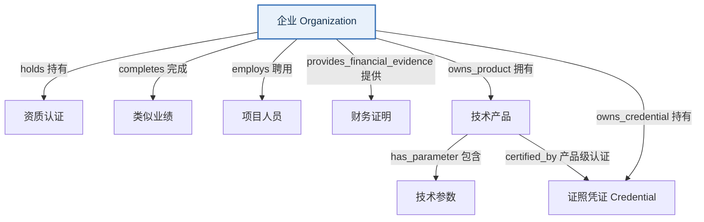

# 簇 3　企业材料本体设计

**版本**：V0.4（证据文件夹化·最终）
**命名空间**：`/tenderhub`
**簇定位**：工作人员填 Excel 模板 → 导入为结构化事实 → 事实回指证据文件夹（evidencePath）→ 事实可被招标匹配引用

> **最终本体（V0.4）**：**8 类 + 8 关系**。
> - 8 类：`Organization`、`QualificationCertificate`、`PerformanceCase`、`StaffMember`、`FinancialEvidence`、`TechnicalProduct`、`TechnicalParameter`、`Credential`。
> - 8 关系：`holds` / `completes` / `employs` / `provides_financial_evidence` / `owns_product` / `has_parameter` / `owns_credential` / `certified_by`。
> - 证据溯源：事实直接挂 `evidencePath`（证据文件夹路径）+ `evidenceUpdatedAt`，**不再有 `EnterpriseMaterial` 类与 `materialId` 外键**。

> **演进历史**：
> - V0.1/V0.2 → V0.3：删除 `EnterpriseProfile` / `EnterpriseCapability` / `MaterialCategory` / `EvidenceUnit`；合并 `ProductCertification` + `IntellectualProperty` → `Credential`（用 `credentialType` 区分）；拆出 `TechnicalParameter`；`Organization` 增规模与能力范围属性；曾保留 `EnterpriseMaterial` 作文件注册表、用 `materialId` 溯源（9 类 + 16 关系）。
> - V0.3 → V0.4：删除 `EnterpriseMaterial`（9 类 → 8 类）与 `materialId` 外键，关系 16 → 8（删除 `owns` + 7 条 `documented_by*` 溯源边），证据改为「一事实一文件夹」的 `evidencePath`。

---

## 一、簇要回答的问题

| 关注点 | 回答的核心问题 | 用途 |
|:---|:---|:---|
| **企业主体** | 企业是谁？规模多大（从业人员/营收/资产/划型）？经营范围与能力？ | 主体信息；中小企业划型判断 |
| **资质** | 企业有哪些营业执照、许可证、体系认证、业绩、人员、财务证明？ | 资格条件匹配 |
| **技术产品** | 企业有哪些产品、参数指标、认证、专利、软著、商标？ | 技术参数详细匹配 |
| **材料归档** | 每条事实的证据在哪个文件夹（evidencePath）？ | 溯源与佐证 |

---

## 二、核心链

> **核心链**：`企业 → 各结构化事实类 → 事实直接挂 evidencePath（证据文件夹）`。实线为管理/归属关系；证据溯源不再走图边，而是各事实类上的 `evidencePath` 属性。

---

## 三、对象类设计

### 3.1 `Organization` 企业（锚点）

| 属性 | 类型 | 说明 |
|:---|:---|:---|
| organizationId | varchar | 主键 |
| organizationName | varchar | 企业全称 |
| organizationType | varchar | 角色：purchaser / agency / bidder |
| unifiedSocialCreditCode | varchar | 统一社会信用代码 |
| legalRepresentative | varchar | 法定代表人 |
| registeredAddress | text | 注册地址 |
| contactInfo | varchar | 联系方式 |
| officialSite | varchar | 官网 |
| aliases | text | 别名 |
| employeeCount | int | 从业人员数 |
| annualRevenueWan | double | 营业收入（万元） |
| totalAssetsWan | double | 资产总额（万元） |
| enterpriseSize | varchar | 企业规模：中型企业 / 小型企业 / 微型企业 |
| description | text | 企业描述（可 LLM 归纳） |
| managementPolicies | text | 管理制度 / 承诺 |
| capabilities | text | 能力清单（可 LLM 归纳，逗号分隔） |
| serviceScope | text | 服务范围（可 LLM 归纳） |
| productScope | text | 产品范围 |
| regionScope | text | 区域范围（可 LLM 归纳） |
| industryScope | text | 行业范围（可 LLM 归纳） |
| scaleValue | double | 规模数值 |
| scaleUnit | varchar | 规模单位 |
| status | varchar | active / inactive |

> 能力/范围字段均为**企业属性**（不建独立能力类），模板填写；检索时可按需由 LLM 归纳总结（`summarize-capabilities`）。

### 3.2 `QualificationCertificate` 资质认证

| 关键属性 | 说明 |
|:---|:---|
| qualificationId | 主键 |
| qualificationType | 基本资质证书 / 体系认证 / 服务与研发资质 / 行业许可证 / 信用等级 / 实验室认可 / 荣誉与奖项 / 会员与行业身份 / 其他 |
| qualificationName | 证书名称 |
| certificateNo / level / issuer / scope | 编号 / 等级 / 发证机构 / 范围 |
| issueDate / validFrom / validUntil | 日期 |
| status / verificationStatus | 状态 / 核验 |
| evidencePath | 证据文件夹相对路径（如 `libraries/company/证明材料/资质认证/3/`） |
| evidenceUpdatedAt | 证据最后更新时间 |
| organizationId | 外键 → Organization |

### 3.3 `PerformanceCase` 类似业绩

| 关键属性 | 说明 |
|:---|:---|
| performanceId | 主键 |
| caseName / customerName | 案例名 / 客户 |
| industry / region / serviceScope | 行业 / 地区 / 服务范围 |
| contractAmount / currency | 合同金额 / 币种 |
| signedDate / completionDate | 签订 / 完成日期 |
| acceptanceStatus / role / contactName | 验收状态 / 角色 / 联系人 |
| evidencePath | 证据文件夹相对路径 |
| evidenceUpdatedAt | 证据最后更新时间 |
| organizationId | 外键 → Organization |

### 3.4 `StaffMember` 项目人员

| 关键属性 | 说明 |
|:---|:---|
| staffId | 主键 |
| name / role / staffType / title | 姓名 / 岗位 / 类型 / 职称 |
| professionalCertificates | 专业证书 |
| yearsOfExperience | 从业年限 |
| employmentStartDate | 入职日期 |
| specialty / currentStatus / resumeSummary | 专业特长 / 状态 / 履历 |
| evidencePath | 证据文件夹相对路径 |
| evidenceUpdatedAt | 证据最后更新时间 |
| organizationId | 外键 → Organization |

### 3.5 `FinancialEvidence` 财务证明

| 关键属性 | 说明 |
|:---|:---|
| financialEvidenceId | 主键 |
| evidenceType | 审计报告 / 银行资信 / 纳税证明 / 社保证明 / 财务报表 / 信用报告 |
| periodStart / periodEnd | 期间起止 |
| issuedBy / issueDate / validUntil | 出具机构 / 日期 |
| revenue / assetAmount | 营收 / 资产 |
| creditLevel / status | 信用等级 / 状态 |
| evidencePath | 证据文件夹相对路径 |
| evidenceUpdatedAt | 证据最后更新时间 |
| organizationId | 外键 → Organization |

### 3.6 `TechnicalProduct` 技术产品

| 关键属性 | 说明 |
|:---|:---|
| productId | 主键 |
| productName / aliases / productType | 名称 / 别名 / 类型（软件平台/系统/引擎/模块/服务包） |
| category / brand / model | 类别 / 品牌 / 型号 |
| description | 描述 |
| applicableScenario | 适用场景 |
| status | 状态 |
| evidencePath | 证据文件夹相对路径 |
| evidenceUpdatedAt | 证据最后更新时间 |
| organizationId | 外键 → Organization |

> `technicalSpecification` 已从本类移除，独立为 `TechnicalParameter`。

### 3.7 `TechnicalParameter` 技术参数

| 关键属性 | 说明 |
|:---|:---|
| parameterId | 主键 |
| description | 参数描述（如"支持最大并发 500 用户"） |
| productId | 外键 → TechnicalProduct |
| evidencePath | 外键 → 证据文件夹（证据文件夹路径） |
| evidenceUpdatedAt | 证据最后更新时间 |
| organizationId | 外键 → Organization |

### 3.8 `Credential` 证照凭证（产品认证 ∪ 知识产权）

| 关键属性 | 说明 |
|:---|:---|
| credentialId | 主键 |
| credentialType | 专利 / 软件著作权 / 商标 / 作品登记 / 检测报告 / 产品认证 / 标准符合性证明 / 兼容性报告 / 测评 |
| credentialName | 名称 |
| registrationNo | 登记号 / 证书号 |
| issuer / owner / standardNo | 发证机构 / 权利人 / 标准号 |
| issueDate / validUntil | 日期 |
| status | 状态 |
| productId | 外键 → TechnicalProduct（可空；空=企业级，非空=产品级） |
| evidencePath | 证据文件夹相对路径 |
| evidenceUpdatedAt | 证据最后更新时间 |
| organizationId | 外键 → Organization |

---

## 四、关系定义（8 条）

### 企业管理（6 条）

| relationName | fromClass | toClass | 说明 |
|:---|:---|:---|:---|
| holds | Organization | QualificationCertificate | 企业持有资质认证 |
| completes | Organization | PerformanceCase | 企业完成类似业绩 |
| employs | Organization | StaffMember | 企业聘用人员 |
| provides_financial_evidence | Organization | FinancialEvidence | 企业提供财务证明 |
| owns_product | Organization | TechnicalProduct | 企业拥有技术产品 |
| owns_credential | Organization | Credential | 企业持有证照凭证 |

### 产品内部 / 产品 ↔ 凭证（2 条）

| relationName | fromClass | toClass | 说明 |
|:---|:---|:---|:---|
| has_parameter | TechnicalProduct | TechnicalParameter | 产品包含技术参数 |
| certified_by | TechnicalProduct | Credential | 产品获得产品级认证 |

> 证据溯源不再表示为图边：每个事实类直接持 `evidencePath`（证据文件夹路径）+ `evidenceUpdatedAt`。查某事实证据时读其 `evidencePath`，再通过 `GET /api/materials/evidence-files?path={}` 按需枚举文件夹内文件。

---

## 五、受控词表

| 词表 | 取值 |
|:---|:---|
| enterpriseSize | 中型企业 / 小型企业 / 微型企业 |
| qualificationType | 基本资质证书 / 体系认证 / 服务与研发资质 / 行业许可证 / 信用等级 / 实验室认可 / 荣誉与奖项 / 会员与行业身份 / 其他 |
| credentialType | 专利 / 软件著作权 / 商标 / 作品登记 / 检测报告 / 产品认证 / 标准符合性证明 / 兼容性报告 / 测评 |
| evidenceType | 审计报告 / 银行资信 / 纳税证明 / 社保证明 / 财务报表 / 信用报告 |
| productType | 软件平台 / 系统 / 引擎 / 模块 / 服务包 |
| acceptanceStatus | accepted / ongoing / pending |
| verificationStatus | 未核验 / 已核验有效 / 已核验过期 / 待人工确认 |
