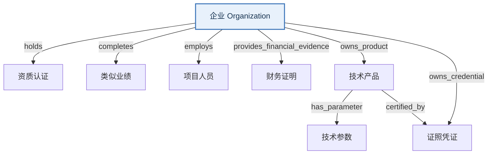

# 企业材料本体介绍

> 本文面向**想理解数据结构的人**（开发、数据治理、对接方）：详细介绍企业材料本体的**对象（类）、属性、关系**，以及每个对象的业务含义。与《企业材料收集表》一一对应。

---

## 一、这是什么

「企业材料本体」是投标智能体对企业侧数据的统一描述：把一家投标企业**有什么**，拆成一套结构化的对象与关系，存进图数据库（M3，命名空间 `/tenderhub`）。

**一句话**：企业 → 一堆事实（资质、业绩、人员、财务、产品、参数、证照）→ 每条事实回指它的证据文件夹（`evidencePath`）。

**规模**：8 个对象类 + 8 条关系。

**设计原则**：
- 能用**类型属性**区分就不建子类（M3 不支持继承）。
- 只建**单向关系**，反向查询走入边。
- 状态、类型、编号分离：编号/类型是属性，瞬时状态也是属性，只有"有独立身份、要追溯"的对象才建类。

---

## 二、八个对象类

### 1. 企业 `Organization`（锚点）

投标企业主体，**所有事实的最终归属**，同时承载企业规模与能力范围。

| 属性 | 类型 | 说明 |
|:---|:---|:---|
| organizationId | varchar | 主键 |
| organizationName | varchar | 企业全称 |
| organizationType | varchar | 角色：purchaser 采购人 / agency 代理机构 / bidder 投标供应商 |
| unifiedSocialCreditCode | varchar | 统一社会信用代码 |
| legalRepresentative | varchar | 法定代表人 |
| registeredAddress | text | 注册地址 |
| contactInfo | varchar | 联系方式 |
| officialSite | varchar | 官网 |
| aliases | text | 别名 |
| employeeCount | int | 从业人员数 |
| annualRevenueWan | double | 营业收入（万元） |
| totalAssetsWan | double | 资产总额（万元） |
| enterpriseSize | varchar | 企业规模：中型企业 / 小型企业 / 微型企业 |
| description | text | 企业描述 |
| managementPolicies | text | 管理制度 / 承诺 |
| capabilities | text | 能力清单（多值，顿号分隔） |
| serviceScope | text | 服务范围 |
| productScope | text | 产品范围 |
| regionScope | text | 区域范围 |
| industryScope | text | 行业范围 |
| scaleValue | double | 规模数值 |
| scaleUnit | varchar | 规模单位 |
| status | varchar | active / inactive |

> **企业规模**由从业人员、营收、资产三项按《中小企业划型标准》判定；四项一起用于「中小企业声明函」和资格门槛判断。

### 2. 资质认证 `QualificationCertificate`

营业执照、体系认证、行业许可证、信用等级等**企业资格证明**。

| 属性 | 类型 | 说明 |
|:---|:---|:---|
| qualificationId | varchar | 主键 |
| qualificationType | varchar | 基本资质证书/体系认证/服务与研发资质/行业许可证/信用等级/实验室认可/荣誉与奖项/会员与行业身份/其他 |
| qualificationName | text | 证书名称 |
| certificateNo | varchar | 证书编号 |
| level | varchar | 等级 |
| issuer | varchar | 发证机构 |
| scope | text | 认证/许可范围 |
| issueDate | date | 颁发日期 |
| validFrom | date | 有效期起 |
| validUntil | date | 有效期止 |
| status | varchar | valid / expired / expiring_soon |
| verificationStatus | varchar | 未核验/已核验有效/已核验过期/待人工确认 |
| evidencePath | varchar | 证据文件夹相对路径（如 `libraries/company/证明材料/资质认证/3/`） |
| evidenceUpdatedAt | timestamp | 证据最后更新时间 |
| organizationId | varchar | 外键 → 企业 |

### 3. 类似业绩 `PerformanceCase`

企业已完成、可用于投标证明的**历史项目案例**。

| 属性 | 类型 | 说明 |
|:---|:---|:---|
| performanceId | varchar | 主键 |
| caseName | varchar | 项目/案例名称 |
| customerName | varchar | 客户名称 |
| industry | varchar | 客户行业 |
| region | varchar | 项目地区 |
| serviceScope | text | 服务范围 |
| contractAmount | double | 合同金额（元） |
| currency | varchar | 币种 |
| signedDate | date | 签订日期 |
| completionDate | date | 完成日期 |
| acceptanceStatus | varchar | accepted / ongoing / pending |
| role | varchar | 主承 / 联合体 / 分包 |
| contactName | varchar | 客户联系人 |
| evidencePath | varchar | 证据文件夹相对路径 |
| evidenceUpdatedAt | timestamp | 证据最后更新时间 |
| organizationId | varchar | 外键 → 企业 |

### 4. 项目人员 `StaffMember`

可用于投标项目的人员事实记录。

| 属性 | 类型 | 说明 |
|:---|:---|:---|
| staffId | varchar | 主键 |
| name | varchar | 姓名 |
| role | varchar | 岗位角色 |
| staffType | varchar | 管理/技术/操作/服务 |
| title | varchar | 职称 |
| professionalCertificates | text | 专业证书 |
| yearsOfExperience | double | 从业年限 |
| employmentStartDate | date | 入职日期 |
| specialty | varchar | 专业特长 |
| currentStatus | varchar | 在职/离职/借调 |
| resumeSummary | text | 简历摘要 |
| evidencePath | varchar | 证据文件夹相对路径 |
| evidenceUpdatedAt | timestamp | 证据最后更新时间 |
| organizationId | varchar | 外键 → 企业 |

### 5. 财务证明 `FinancialEvidence`

审计报告、银行资信、纳税证明、社保证明等**财务与信用证明**。

| 属性 | 类型 | 说明 |
|:---|:---|:---|
| financialEvidenceId | varchar | 主键 |
| evidenceType | varchar | 审计报告/银行资信/纳税证明/社保证明/财务报表/信用报告 |
| periodStart / periodEnd | date | 覆盖期间起/止 |
| issuedBy | varchar | 出具机构 |
| issueDate | date | 出具日期 |
| validUntil | date | 有效期止 |
| revenue | double | 营收（元） |
| assetAmount | double | 总资产（元） |
| creditLevel | varchar | 信用等级 |
| status | varchar | 状态 |
| evidencePath | varchar | 证据文件夹相对路径 |
| evidenceUpdatedAt | timestamp | 证据最后更新时间 |
| organizationId | varchar | 外键 → 企业 |

### 6. 技术产品 `TechnicalProduct`

企业可交付的技术产品、软件系统或服务模块。

| 属性 | 类型 | 说明 |
|:---|:---|:---|
| productId | varchar | 主键 |
| productName | varchar | 产品名称 |
| aliases | text | 别名 |
| productType | varchar | 软件平台/系统/引擎/模块/服务包 |
| category | varchar | 分类 |
| brand | varchar | 品牌 |
| model | varchar | 型号 |
| description | text | 产品描述 |
| applicableScenario | text | 适用场景 |
| status | varchar | 状态 |
| evidencePath | varchar | 证据文件夹相对路径 |
| evidenceUpdatedAt | timestamp | 证据最后更新时间 |
| organizationId | varchar | 外键 → 企业 |

### 7. 技术参数 `TechnicalParameter`

技术产品的**参数指标**（原「技术规格」独立成类）。

| 属性 | 类型 | 说明 |
|:---|:---|:---|
| parameterId | varchar | 主键 |
| description | text | 参数描述（如"支持最大并发 500 用户"） |
| productId | varchar | 外键 → 技术产品 |
| evidencePath | varchar | 证据文件夹相对路径 |
| evidenceUpdatedAt | timestamp | 证据最后更新时间 |
| organizationId | varchar | 外键 → 企业 |

### 8. 证照凭证 `Credential`（产品认证 ∪ 知识产权）

企业/产品持有的认证、检测报告与知识产权（专利/软著/商标等）。**合并自「产品认证」+「知识产权」两类**，用 `credentialType` 区分，用可空 `productId` 区分产品级/企业级。

| 属性 | 类型 | 说明 |
|:---|:---|:---|
| credentialId | varchar | 主键 |
| credentialType | varchar | 专利/软件著作权/商标/作品登记/检测报告/产品认证/标准符合性证明/兼容性报告/测评 |
| credentialName | text | 名称 |
| registrationNo | varchar | 登记号/证书号 |
| issuer | varchar | 发证机构 |
| owner | varchar | 权利人 |
| standardNo | varchar | 依据标准号 |
| issueDate | date | 取得/出具日期 |
| validUntil | date | 有效期止 |
| status | varchar | 状态 |
| productId | varchar | 外键 → 技术产品（可空；空=企业级，非空=产品级） |
| evidencePath | varchar | 证据文件夹相对路径 |
| evidenceUpdatedAt | timestamp | 证据最后更新时间 |
| organizationId | varchar | 外键 → 企业 |

> **产品认证 vs 知识产权**：产品认证是产品获得的第三方检测/认证（挂产品，`productId` 非空）；知识产权是企业拥有的权利（挂企业，`productId` 空）。字段高度重叠，故合并为一类。

---

## 三、八条关系

### 企业管理关系（7 条）—— 企业「拥有」哪些事实

| 关系名 | 从 → 到 | 含义 |
|:---|:---|:---|
| holds | 企业 → 资质认证 | 企业持有资质 |
| completes | 企业 → 类似业绩 | 企业完成业绩 |
| employs | 企业 → 项目人员 | 企业聘用人员 |
| provides_financial_evidence | 企业 → 财务证明 | 企业提供财务证明 |
| owns_product | 企业 → 技术产品 | 企业拥有产品 |
| owns_credential | 企业 → 证照凭证 | 企业持有证照 |

### 产品内部 / 产品 ↔ 凭证（1 条）

| 关系名 | 从 → 到 | 含义 |
|:---|:---|:---|
| has_parameter | 技术产品 → 技术参数 | 产品包含参数 |
| certified_by | 技术产品 → 证照凭证 | 产品获得产品级认证 |

> `certified_by` 只在凭证 `productId` 非空（产品级）时生效；企业级凭证只挂企业（`owns_credential`）。

### 证据溯源（约定，非图边）

每个事实类不再通过 `documented_by*` 边回指材料，而是直接持有一个 `evidencePath`（证据文件夹相对路径）字段。证据就是一个「事实 → 一个文件夹路径」，文件夹内的文件在应用层按需枚举（后端 `GET /api/materials/evidence-files?path={evidencePath}`，文件经 `/runtime/{相对路径}` 提供）。`evidenceUpdatedAt` 记录文件夹最后更新时间。

### 关系方向与外键镜像（一条关系，两种表达）

图里的边是**有向、单向**的，方向 = 语义方向，一律从「一」指向「多」：

- 管理关系：企业 → 事实（`holds`、`employs`、`owns_product`…）

同一条关系还保留一条**方向相反的外键镜像**，存在「多」这一侧。两者互补，不是矛盾：

| 表达 | 方向 | 存在哪 | 例子 |
|:---|:---|:---|:---|
| 图边（有向） | 一 → 多 | 源顶点的出边字段 | `organization.employs` = 24 条出边 |
| 外键（关系型） | 多 → 一 | 事实顶点的字段 | `staff.organization_id` = `org-001` |

**查询约定**：

- 「从多查一」读外键（唯一回指，无需走边）：查某人的组织 → 读 `staff.organization_id`。
- 「从一查多」走边：查企业有哪些人 → 读 `organization.employs`（出边）。
- 「查证据」读 `evidencePath`：查某事实的证据文件 → 读 `qualification.evidence_path`，再按需枚举文件夹内容。

> 例：`employs` 的方向是「企业 → 人员」（企业**聘用**人员），没有搞反。从人员侧查组织直接读 `organization_id` 外键即可；若确需「人员正向走一条边到组织」，那是另一条关系（如 `employed_by`），不是把 `employs` 反过来。

---

## 四、关系总图

实线 = 管理/归属关系；证据溯源由各事实类的 `evidencePath` 字段表达（无图边）。

---

## 五、与收集模板的对应关系

| 收集表 sheet | 本体类 | 关系 |
|:---|:---|:---|
| 企业基本信息 | Organization | 锚点 |
| 资质认证 | QualificationCertificate | holds（证据 → evidencePath） |
| 类似业绩 | PerformanceCase | completes（证据 → evidencePath） |
| 项目人员 | StaffMember | employs（证据 → evidencePath） |
| 财务证明 | FinancialEvidence | provides_financial_evidence（证据 → evidencePath） |
| 技术产品 | TechnicalProduct | owns_product + has_parameter（证据 → evidencePath） |
| 技术参数 | TechnicalParameter | has_parameter（证据 → evidencePath） |
| 证照凭证 | Credential | owns_credential + certified_by（证据 → evidencePath） |
