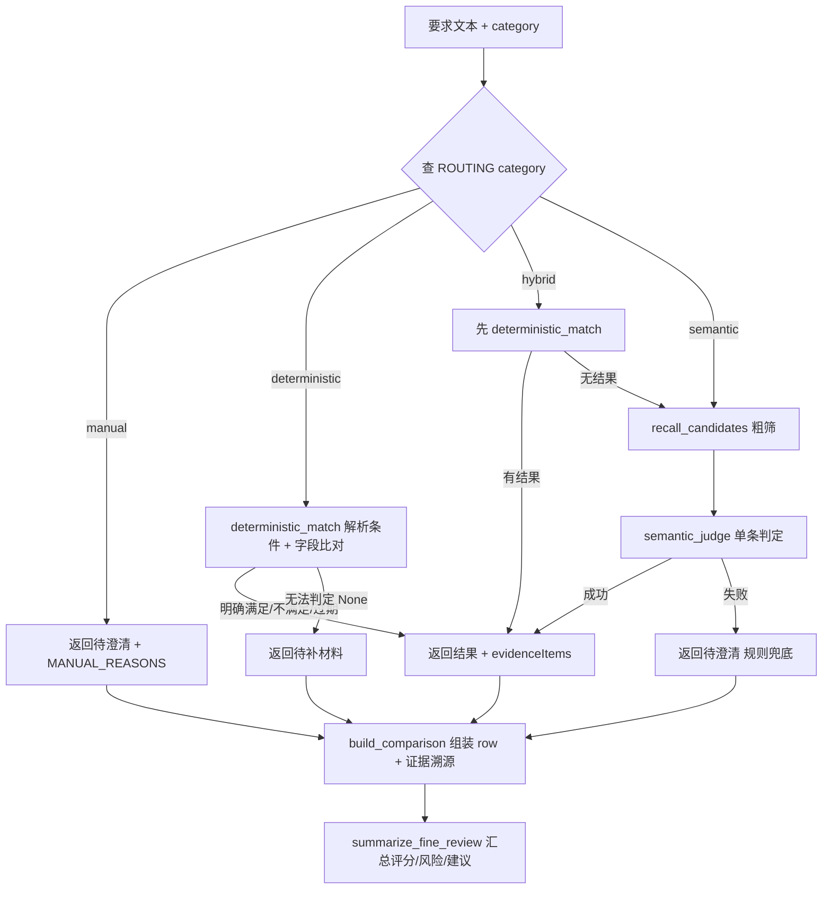

# 匹配引擎开发计划（施工文档）

> **状态**：待执行 → 本文档为最终施工口径 | **负责人**：匹配模块
> **边界依据**：`docs/解析与匹配模块边界.md`
> **参考实现**：`tender-agent/BidDataHub/`（筑标AI 供数层，只读不抄全）
> **决策记录**：文档落点=覆盖升级本文件；数据层=新建 `company_facts.py` + 缓存 `self._company_facts`；路由范围=只改 fine review；等级值域=甲乙丙/壹贰叁/一二三+特级+不分等级（无 ABC）；金额口径=统一「元」；验收数据=M3 真实 facts。

---

## 0. 目标与范围边界

### 0.1 目标

把 `tender_matching/` 里的匹配从「关键词子串 + 投影字段不全」升级为：

```
M3 事实源（全量 CamelCase 台账）
  → 确定性比对（等级/数量/日期/金额/地域）
  → LLM 语义判定（仅兜底模糊项）
  → 路由分发（15 类全覆盖）
  → 每行要求输出：满足 / 部分满足 / 不满足 / 待补材料 / 待澄清 / 不适用 + 企业证据 + 一句话原因
```

交付后：上传一份招标文件点分析 → 每行要求自动给出上述 6 态之一 + `evidenceItems` + `reason`，人工只复核低置信 / manual / 否决项。

### 0.2 范围边界（依据「解析与匹配模块边界」）

三层职责，本文档只做**匹配层**：

| 层 | 职责 | 本文档动作 |
| --- | --- | --- |
| 解析层 | 还原文档（段落/表格/章节） | 不改 |
| 提取层 | 识别要求（`category`/`mandatory`/`isRejection`/来源定位） | 不改，只消费其输出的 `category` 驱动路由 |
| 匹配层 | 核对企业能力与证据 | **本文档全部内容** |

**明确不在此范围**：
- `document_parser.py` / `document_structure.py` / `requirement_scope.py` — 不改；
- `document_fine_matching.py` 中的**提取函数**（`extract_tender_requirements` 等） — 不改；
- `evaluate_announcement_eligibility`（公告资格预审入口） — **本轮不改**，路由只接 `evaluate_tender_document`；
- 前端（`frontend/`、`MatchingPage.vue`、`types.ts`） — 不改，匹配层必须只产出前端已认识的 6 态契约；
- M3 连接细节（`m3/client.py` / `m3/sync.py`） — 只消费 `read_facts_from_m3` 的返回值，不改内部。

### 0.3 状态契约（重要，前端只认这 6 个）

```text
满足 | 部分满足 | 不满足 | 待补材料 | 待澄清 | 不适用
```

- `contracts.py::MATCH_STATUSES` 即上述 6 值，`frontend` 的审核按钮也只渲染这 6 个。
- **任何内部状态「需人工核验」一律落「待澄清」**，不得新增第 7 态（否则前端不渲染）。语义精排与确定性匹配的输出必须归一化到这 6 态。

---

## 1. 文件清单 + BidDataHub 参考对照表

### 1.1 要改/新建（tender-agent 内）

| 文件 | 动作 | 说明 |
| --- | --- | --- |
| `backend/app/tender_matching/company_facts.py` | **新建** | M3 facts → 全量 CamelCase 台账视图（地基） |
| `backend/app/tender_matching/deterministic.py` | **新建** | 确定性匹配器（移植 BidDataHub）+ 分发器 |
| `backend/app/tender_matching/semantic_judge.py` | **新建** | LLM 单条判定（含提示词 + JSON 提取） |
| `backend/app/store.py` | **修改** | 缓存 `self._company_facts`；`match_project` 喂台账视图 |
| `backend/app/tender_matching/document_matching.py` | **修改** | `evaluate_tender_document` 逐条循环接路由分发 |
| `backend/tests/test_matching.py` + `backend/tests/gold.json` | **新建** | 确定性函数单测 + 评测基线 |

> 边界说明：`store.py`、`contracts.py`、`document_matching.py` 属于「共享编排/匹配层」文件。本文档只新增匹配层函数、只替换 `evaluate_tender_document` 的逐条匹配逻辑，**不改变** `evaluate_tender_document` 的签名、`RequirementExtraction` 字段语义、`fineReview` 的 6 态契约。

### 1.2 参考实现（BidDataHub 内，只读不抄全）

| BidDataHub 文件·函数 | 移植到 | 用途 |
| --- | --- | --- |
| `app/config.py:50` `LEVEL_RANK` | `deterministic.py` | 资质等级序（值域已确认一致） |
| `app/matcher/qualification.py:14` `match_qualification` | `deterministic.py` | 等级+行业匹配 |
| `app/matcher/personnel_solver.py:12` `parse_personnel_req` + `:53` `solve_personnel` | `deterministic.py` | 人员约束求解 |
| `app/matcher/similarity.py:21` `parse_performance_req` + `:47` `score_projects` | `deterministic.py` | 业绩金额/时间/行业打分 |
| `app/llm/client.py:76` `extract_json` | `semantic_judge.py` | 代码块剥离 + 括号兜底（LLM 调用仍用现有 `eligibility.call_openai_compatible`） |
| `benchmark/evaluate.py` + `gold.json` | `backend/tests/` | 评测框架 |

---

## 2. M3 8 类字段速查（精确 CamelCase + 值域 + 单位）

> 来源：`backend/app/document_recognition/ontology_defs.py::CLASS_SCHEMA`。
> `read_facts_from_m3()` 返回的 facts 键为 snake_case（`organization` + 7 个列表键），**行内字段是 CamelCase**（`m3/sync.py::_row_to_camel` 已转回）。
> 每个事实类都带公共字段：`organizationId`（外键）、`evidencePath`（证据文件夹相对路径）、`evidenceUpdatedAt`（证据更新时间）。

### 2.1 8 类字段（★=主键）

**qualification_certificate（资质认证）** — 键 `qualification_certificate`
```
★qualificationId
qualificationType, qualificationName, certificateNo, level, issuer, scope,
issueDate, validFrom, validUntil, status, verificationStatus
```

**credential（证照凭证：软著/专利/检测报告/产品认证）** — 键 `credential`
```
★credentialId
credentialType, credentialName, registrationNo, standardNo, issuer, owner,
issueDate, validUntil, status, productId
```

**performance_case（类似业绩）** — 键 `performance_case`
```
★performanceId
caseName, customerName, industry, region, serviceScope, contractAmount, currency,
signedDate, completionDate, acceptanceStatus, role, contactName
```

**staff_member（项目人员）** — 键 `staff_member`
```
★staffId
name, role, staffType, title, professionalCertificates, yearsOfExperience,
employmentStartDate, specialty, currentStatus, resumeSummary
```

**financial_evidence（财务证明）** — 键 `financial_evidence`
```
★financialEvidenceId
evidenceType, periodStart, periodEnd, issuedBy, issueDate, validUntil,
revenue, assetAmount, creditLevel, status
```

**technical_product（技术产品）** — 键 `technical_product`
```
★productId
productName, aliases, productType, category, brand, model, description,
applicableScenario, status
```

**technical_parameter（技术参数）** — 键 `technical_parameter`
```
★parameterId
description, productId
```

**organization（企业主体，单对象）** — 键 `organization`
```
★organizationId
organizationName, organizationType, unifiedSocialCreditCode, legalRepresentative,
registeredAddress, contactInfo, officialSite, aliases,
employeeCount, annualRevenueWan, totalAssetsWan, enterpriseSize,
description, managementPolicies, capabilities, serviceScope, productScope,
regionScope, industryScope, scaleValue, scaleUnit, status
```

### 2.2 单位口径（⚠️ 本次确认）

| 字段 | 单位 | 匹配中的用法 |
| --- | --- | --- |
| `contractAmount` | **元** | 业绩金额打分，与需求金额同口径比较 |
| `revenue` / `assetAmount` | **元** | 财务指标比对 |
| `annualRevenueWan` / `totalAssetsWan` | **万元**（字段名后缀 Wan 显式标注） | 企业规模类要求；与元字段混用时需 ×10000 |
| `employeeCount` | 人 | 人员规模要求 |
| `scaleValue` + `scaleUnit` | 组合（数值+单位） | 规模类要求 |

> 规则：**需求里的「X万元 / X万」统一 ×10000 换算成「元」后再与 `contractAmount`/`revenue`/`assetAmount` 比较**；与 `annualRevenueWan`/`totalAssetsWan` 比较则保持万元口径。

### 2.3 值域（已确认的）

| 字段 | 值域 | 匹配中的用法 |
| --- | --- | --- |
| `level`（资质） | `特级` / `甲级` / `乙级` / `丙级` / `壹级` / `贰级` / `叁级` / `一级` / `二级` / `三级` / `不分等级`（**无 ABC**） | `LEVEL_RANK` 映射（见 §4.2）；未识别的 level 走「待澄清」 |
| `verificationStatus` | `未核验` / `已核验有效` / `已核验过期` / `待人工确认` / `有效` | `∈ {"已核验有效","有效"}` 才视为可信证据 |
| `currentStatus`（人员） | `在职` / `离职` | `== "在职"` 才可派出 |
| `acceptanceStatus`（业绩） | `accepted` / `ongoing` / `pending` | 业绩验收状态；`accepted` 优先 |
| `status`（资质/凭证/产品/财务） | 以 `verificationStatus`/`currentStatus` 优先；`status` 仅兜底 | 判定有效性 |

---

## 3. 阶段 0：接线（地基，必须先做）

### 3.0 为什么必须有这一层

`store._refresh_company_from_m3` 当前把 `company_knowledge` 填成 `build_company_knowledge + build_eligibility_knowledge` 的合并，但这两个投影**字段不全**，确定性匹配器跑不起来：

- `qualifications` 记录里 `level` 被拼进 `description` 字符串，无独立字段；
- `projectReferences` 记录**无** `contractAmount` / `completionDate`；
- `personnel` 记录**无** `currentStatus` / `yearsOfExperience`（`professionalCertificates`/`specialty`/`title` 拼在 description）。

因此新建 `company_facts.py` 输出**保留全量 CamelCase 字段**的台账视图，并在 `store.py` 缓存原始 facts。

### 3.1 新建 `company_facts.py`

函数命名定为 `build_company_ledger`（避免与 `document_recognition/storage.build_company_knowledge` 同名冲突）。

```python
# backend/app/tender_matching/company_facts.py
from typing import Any

def build_company_ledger(facts: dict[str, Any]) -> dict[str, Any]:
    """M3 facts（snake_case 键 + CamelCase 行字段）→ 全量字段台账视图。

    返回结构（键名 = 匹配侧统一消费名，行字段保持 M3 CamelCase 原名，不在此改名）：
    {
        "certificates": [...],   # QualificationCertificate + Credential 合并，带 _source 区分
        "personnel": [...],      # StaffMember
        "projects": [...],       # PerformanceCase
        "finance": [...],        # FinancialEvidence
        "products": [...],       # TechnicalProduct
        "parameters": [...],     # TechnicalParameter
        "organization": {...},   # Organization（单对象，无则 {}）
    }
    """
```

实现要点：
1. `certificates = [{"_source": "qualification_certificate", **row} for row in facts.get("qualification_certificate", [])] + [{"_source": "credential", **row} for row in facts.get("credential", [])]`；
2. 其余键直接透传对应 facts 列表（`personnel`/`projects`/`finance`/`products`/`parameters`）；
3. `organization = facts.get("organization") or {}`；
4. **字段名保留 M3 原样（CamelCase），不要在 `company_facts.py` 改名**——改名统一放在 `deterministic.py` 各函数内部，保证台账可溯源、证据 `evidencePath` 可直取。

### 3.2 修改 `store.py`

```python
# _refresh_company_from_m3 内（现有 L289-295 附近），加缓存原始 facts：
try:
    facts = read_facts_from_m3(build_m3_client(self))
    self.company = build_profile(facts)
    self._company_facts = facts                       # ★ 新增：缓存原始 CamelCase facts
    self.company_knowledge = {
        **build_company_knowledge(facts),             # 保留：机会发现词表
        **build_eligibility_knowledge(facts),         # 保留：公告预审 + 兼容旧路径
    }
    ...
```

`match_project`（现有 L601-609）里给 `evaluate_tender_document` 喂台账视图：

```python
from .tender_matching.company_facts import build_company_ledger

if document.get("kind") == "tender_document":
    ledger = build_company_ledger(getattr(self, "_company_facts", {}))
    result["fineReview"] = evaluate_tender_document(
        text,
        document.get("segments", []),
        ledger,                                        # ★ 改为台账视图
        ensure_config(self.config).get("ai", {}),
        source_file_id,
        document.get("sections", []),
        document.get("tables", []),
    )
```

> `evaluate_announcement_eligibility`（公告预审）继续吃 `self.company_knowledge`（旧投影），本轮不改。

### 3.3 阶段 0 自测

```python
# 在 backend venv 里跑（M3 已配置时用真实 facts）
from app.store import Store
from app.tender_matching.company_facts import build_company_ledger
from pathlib import Path

store = Store(Path(".."))          # 指向 backend 上级的项目根
store.initialize()
ledger = build_company_ledger(getattr(store, "_company_facts", {}))
assert isinstance(ledger, dict)
assert isinstance(ledger.get("certificates"), list)
assert isinstance(ledger.get("personnel"), list)
assert isinstance(ledger.get("projects"), list)
assert isinstance(ledger.get("finance"), list)
assert isinstance(ledger.get("organization"), dict)
print("certificates:", len(ledger["certificates"]),
      "personnel:", len(ledger["personnel"]),
      "projects:", len(ledger["projects"]),
      "finance:", len(ledger["finance"]))
# 抽查一个 certificates 元素是否保留原始 CamelCase 字段：
if ledger["certificates"]:
    c = ledger["certificates"][0]
    assert "_source" in c and ("qualificationName" in c or "credentialName" in c)
```

---

## 4. 阶段 1：确定性匹配器（移植 BidDataHub，不依赖 LLM）

### 4.1 通用约定

- **返回语义**：`dict | None`。`None` = 「无法确定性判定 / 找不到对应记录」，让路由决定兜底（`deterministic` 类别 → 待补材料；`hybrid`/`semantic` 类别 → 交给 LLM）。
- **返回 dict 的 `status` 必须 ∈ 6 态契约**（§0.3）。判断「需人工核验」时输出 `"待澄清"`。
- **金额单位**：所有需求金额经 `_to_yuan` 归一化到「元」后比较。
- **统一返回结构**：

```python
{
    "status": "满足|部分满足|不满足|待补材料|待澄清|不适用",
    "matchedFactIds": ["主键值", ...],
    "reason": "一句话依据，引用事实里的具体数值/名称",
    "enterprise_value": "企业侧取值摘要（可选）",
    "statusSource": "确定性规则",
}
```

### 4.2 资质等级比较

**签名**：
```python
def parse_qualification_req(text: str) -> dict:
    """正则抠行业词 + 等级，返回 {"category": str, "level": str}"""

def match_qualification(req_text: str, certificates: list[dict]) -> dict | None
```

**等级序**（值域已确认，与 BidDataHub 一致，无 ABC）：
```python
LEVEL_RANK = {
    "特级": 5, "甲级": 5,
    "壹级": 4, "一级": 4, "乙级": 4,
    "贰级": 3, "二级": 3, "丙级": 3,
    "叁级": 2, "三级": 2, "丁级": 2,
    "不分等级": 1, "无": 0, "": 0,
}
```

**逻辑**（对照 `BidDataHub/app/matcher/qualification.py:32`）：
1. `parse_qualification_req` 拆 category + level；
2. 在 `certificates` 里找 `qualificationName` 含行业关键词的证书（credential 用 `credentialName`，可放宽到 `name` 归一化）；
3. 命中证书 → 比 `LEVEL_RANK[cert.level] >= LEVEL_RANK[req.level]`；
4. 校验 `verificationStatus ∈ {"已核验有效","有效"}`，否则 → `"待澄清"`（状态待核验）；
5. 校验 `validUntil`（`check_date_valid`），早于今天 → `"不满足"`（已过期）；
6. **返回 None** = 无匹配证书（让路由决定兜底）；
7. 返回 dict = `{status, matchedFactIds, reason, enterprise_value, statusSource}`。

**移植差异提醒**：BidDataHub 用 `cert.get("name")` + `cert.get("status")=="在用"`；我方证书字段是 `qualificationName`/`credentialName` + `verificationStatus`，且等级不足判断逻辑（`req_rank > cert_rank → 不满足`）直接保留。

### 4.3 人员约束求解

**签名**：
```python
def parse_personnel_req(text: str) -> dict:
    """→ {"level": str, "type": str, "major": str, "count": int}"""

def solve_personnel(req_text: str, personnel: list[dict]) -> dict | None
```

**⚠️ 移植注意（professionalCertificates ≠ qualification）**：
BidDataHub 拼的是 `qualification + qual_major + title`（三个独立字段）；我方 M3 **没有** `qualification`/`qual_major`，要拼 **`professionalCertificates + specialty + title`**（`professionalCertificates` 是自由文本，含「建造师/工程师」等词，不是结构化等级字段）。

**逻辑**（对照 `BidDataHub/app/matcher/personnel_solver.py:53`）：
1. `parse_personnel_req` 拆 level（高级/一级/二级/壹级/贰级/中级/初级）+ type（建造师/工程师/技术负责人…）+ major（括号内专业）+ count（X名/X人/X个）；
2. 对每个人员拼 `blob = f"{professionalCertificates} {specialty} {title}"`，判 type 命中、level 满足、major 命中；
3. 追加我方特有约束：`currentStatus == "在职"`；
4. 统计 `satisfied = len(available) >= count`，输出 `shortfall = max(0, count - len(available))`；
5. 返回 `{status: "满足"|"不满足", matchedFactIds, reason(含人数与缺口), enterprise_value, statusSource}`；`count == 0` 或解析不出人员要求 → `None`。

**字段名差异对照**：
| BidDataHub | 我方 M3 |
| --- | --- |
| `qualification` | `professionalCertificates`（自由文本） |
| `qual_major` | `specialty` |
| `title` | `title`（一致） |
| `status（在职/可用）` | `currentStatus` |

### 4.4 业绩相似度打分

**签名**：
```python
def parse_performance_req(text: str) -> dict:
    """→ {"amount_yuan": float|None, "years": int|None, "industry_words": list[str]}"""

def score_performance(req_text: str, projects: list[dict]) -> dict | None
```

**打分因子**（对照 `BidDataHub/app/matcher/similarity.py:47`）：金额贴近度 40 分 + 时间新鲜度 30 分 + 行业匹配 30 分。

**⚠️ 移植差异提醒**：
- BidDataHub 用 `complete_date` 算时间，我方是 **`completionDate`**；
- BidDataHub 金额单位是「万」，我方 `contractAmount` 是 **「元」**，`parse_performance_req` 必须把需求的「X万/X万元」×10000 归一到元再比；
- 我方字段 `contractAmount`（非 `contract_amount`）、`industry`（非 `name` 内的行业）。

**逻辑**：对每个 project 打分并降序；`amount_yuan` 达标 40 分，否则按 `40 * 实际/要求` 折算；`completionDate` 距今年龄越近分越高（近1年30、近2年25、近3年20、近5年10、更早5）；行业词命中 30。取 top1（或达标条数），返回满足/不满足 + 证据 id。

### 4.5 财务匹配

**签名**：
```python
def match_financial(req_text: str, finance: list[dict], organization: dict | None = None) -> dict | None
```

**逻辑**（对照 `BidDataHub/app/matcher/qualification.py:109` 思路，但改为确定性数值比较）：
1. 从要求抠「净资产≥X / 营收≥Y / 资产总额≥Z」等指标 + 阈值（`_parse_amount` + `_to_yuan`）；
2. 与 `FinancialEvidence.revenue`/`assetAmount`（元）比对；`organization` 的 `annualRevenueWan`/`totalAssetsWan`（万元）作兜底并 ×10000；
3. `creditLevel`/`status` 参与软性判断；
4. 解析不出任何数值指标 → `None`（交给 LLM）。

### 4.6 地域匹配

**签名**：
```python
def match_region(req_text: str, organization: dict) -> dict | None
```

**逻辑**：从要求抠地域词（如「福建省内」「注册地」），检查 `organization.regionScope`（可 `_split_text` 成列表）是否包含；命中 → 满足（证据 = organization），不命中或无法确定 → `None`。

### 4.7 通用日期/数量硬判定（新增，BidDataHub 无完整实现）

```python
def check_date_valid(valid_until: str, today: date | None = None) -> bool:
    """validUntil 是否仍有效（>= today）；空串/无法解析 → True（不误杀）。"""

def check_count_requirement(required: int, actual: int) -> bool:
    """'不少于/至少 N 个' vs 实际条数。"""
```

### 4.8 分发器（原草案缺签名，此处补上）

```python
def deterministic_match(req_text: str, category: str, company: dict) -> dict | None:
    """按 category 选确定性函数；无法判定返回 None。"""
    if category == "qualification":
        return match_qualification(req_text, company.get("certificates", []))
    if category == "performance":
        return score_performance(req_text, company.get("projects", []))
    if category == "personnel":
        return solve_personnel(req_text, company.get("personnel", []))
    if category == "financial":
        return match_financial(req_text, company.get("finance", []), company.get("organization"))
    if category == "region":
        return match_region(req_text, company.get("organization") or {})
    return None
```

### 4.9 确定性单测（写进 `test_matching.py`）

```python
cert = {"_source": "qualification_certificate", "qualificationId": "q-001",
        "qualificationName": "建筑工程施工总承包", "level": "贰级",
        "verificationStatus": "已核验有效", "validUntil": "2027-06-01"}
assert match_qualification("建筑工程施工总承包贰级及以上", [cert])["status"] == "满足"

staff = {"staffId": "s-001", "name": "张三", "professionalCertificates": "一级建造师",
         "specialty": "建筑工程", "title": "高级工程师", "currentStatus": "在职"}
assert solve_personnel("一级建造师（建筑工程专业）2名", [staff])["status"] == "不满足"  # 只有1人
```

---

## 5. 阶段 2：语义精排（LLM 单条判定）

### 5.1 新建 `semantic_judge.py`

```python
def semantic_judge(req_text: str, category: str, candidates: list[dict], ai: dict) -> dict | None:
    """LLM 判定单条要求；失败返回 None（路由兜底「待澄清」）。"""

def recall_candidates(category: str, company: dict, top_k: int = 5) -> list[dict]:
    """按类别取对应企业类全量 + 简单关键词粗筛；量大了再换 embedding。"""

def extract_json(content: str) -> dict | None:
    """参照 BidDataHub/app/llm/client.py:76：代码块剥离 + []/{}/{} 兜底。"""
```

- LLM 调用复用现有 `eligibility.call_openai_compatible`（已有重试/超时/response_format 兜底），**不**移植 BidDataHub 的 `httpx` 直连。
- `recall_candidates` 映射：`qualification→certificates`、`performance→projects`、`personnel→personnel`、`financial→finance`、`technical→products+parameters`、`compliance→certificates`、`other→全类截断`。

### 5.2 完整 judge prompt

**System Prompt**：
```
你是资深招投标合规评审专家。你的任务是：对一条招标要求，判断企业给定的事实能否满足。

硬性规则：
1. 只依据【招标要求原文】和【候选事实】判断，禁止补写、禁止臆测企业没有的事实。
2. 金额、数量、日期、资质等级必须按数值比较：
   - 要求"不少于3个"而事实只有2个 → 不满足（数量不足）
   - 要求"一级"而事实是"二级" → 不满足（等级不足）
   - 证书 validUntil 早于今天 → 不满足（已过期）
3. 事实里没有对应信息、或信息不足以判断时，输出"待澄清"，不要硬判满足。
4. 否决性要求（废标/无效投标/否决）不确定时，宁可"待澄清"也不能判"满足"。
5. 输出状态只能取：满足 | 部分满足 | 不满足 | 待澄清 | 不适用。
6. 每一条只输出一个 JSON 对象，不要解释文字，不要 Markdown。
```

**User Prompt 模板**：
```
【招标要求】{requirement}
【要求分类】{category}
【候选事实】（企业库中可能相关的事实，金额单位为元）
1. [ID:{fact_id}] {fact_fields}
2. ...

请判断该要求是否满足，输出一个 JSON 对象。
```

**输出 JSON Schema**（状态收缩到 6 态契约内）：
```json
{
  "status": "满足 | 部分满足 | 不满足 | 待澄清 | 不适用",
  "matchedFactIds": ["主键ID1", "主键ID2"],
  "reason": "一句话依据，必须引用事实里的具体数值或名称",
  "missing": "缺什么（不满足/待澄清时必填，满足时为空）",
  "confidence": 0.92
}
```

**示例**（输入）：
```
【招标要求】近三年承担过不少于3个智慧园区数字孪生平台项目
【候选事实】
1. [ID:perf-001] 某园区数字孪生平台 / 2024-06 完成 / 3200000元 / 行业:智慧园区
2. [ID:perf-002] 某园区可视化平台 / 2025-01 完成 / 1800000元 / 行业:智慧园区
```

**期望输出**：
```json
{
  "status": "不满足",
  "matchedFactIds": ["perf-001", "perf-002"],
  "reason": "候选业绩仅2条，少于要求的3个",
  "missing": "还缺1个类似业绩",
  "confidence": 0.95
}
```

### 5.3 LLM 调用参数

- `temperature=0`（判定任务不要创造性）
- `max_tokens=1500`
- 复用 `eligibility.call_openai_compatible`（已有重试/超时；可传 `response_format`，400 时它自动剥 JSON Schema 重试）
- 失败/解析失败 → 返回 `None`，路由落 `"待澄清"` + `statusSource="规则兜底"`

---

## 6. 阶段 3：路由分发 + 证据溯源

### 6.1 ROUTING 表（15 类全覆盖）

```python
# 在 company_facts.py 或 deterministic.py 顶部
ROUTING: dict[str, tuple[str, list[str]]] = {
    # (method, 要查的企业类)
    "qualification": ("deterministic", ["certificates"]),
    "performance":   ("deterministic", ["projects"]),
    "personnel":     ("deterministic", ["personnel"]),
    "financial":     ("deterministic", ["finance"]),
    "region":        ("deterministic", ["organization"]),
    "technical":     ("hybrid",       ["products", "parameters"]),
    "compliance":    ("hybrid",       ["products", "parameters", "certificates", "capabilities"]),
    "credit":        ("manual",       []),
    "service_plan":  ("semantic",     ["capabilities", "products"]),
    "commercial":    ("manual",       []),
    "document":      ("manual",       []),
    "pricing":       ("manual",       []),
    "contract":      ("manual",       []),
    "rejection":     ("manual",       []),
    "other":         ("semantic",     []),
}
```

> ⚠️ 原草案伪代码写 `if method == "hyper"`，是笔误；统一为 `"hybrid"`。

### 6.2 `match_one_requirement` 伪代码

```python
def match_one_requirement(req: dict, category: str, company: dict, ai: dict) -> dict:
    method, class_keys = ROUTING.get(category, ("semantic", []))

    if method == "deterministic":
        result = deterministic_match(req["text"], category, company)
        if result:
            return result
        return {"status": "待补材料", "reason": "企业事实库中未找到对应记录", "matchedFactIds": [],
                "statusSource": "确定性规则"}

    if method == "hybrid":                       # ★ 修正：hybrid 不是 hyper
        result = deterministic_match(req["text"], category, company)
        if result:
            return result
        candidates = recall_candidates(category, company)
        result = semantic_judge(req["text"], category, candidates, ai)
        if result:
            return result
        return {"status": "待澄清", "reason": "确定性方法和语义判定均无法确认",
                "matchedFactIds": [], "statusSource": "规则兜底"}

    if method == "semantic":
        candidates = recall_candidates(category, company)
        result = semantic_judge(req["text"], category, candidates, ai)
        return result or {"status": "待澄清", "reason": "语义判定失败",
                          "matchedFactIds": [], "statusSource": "规则兜底"}

    # manual
    return {
        "status": "待澄清",
        "reason": MANUAL_REASONS.get(category, "该类别需人工确认"),
        "matchedFactIds": [],
        "statusSource": "人工确认",
    }
```

> 接入点：`document_matching.py::evaluate_tender_document` 的逐条循环（现有 L361-393），把 `_candidate_records → _evidence_for_records → _status_from_evidence` 三步替换为 `match_one_requirement` + 证据溯源。

### 6.3 MANUAL_REASONS（6 个 manual 类别；service_plan 已改为 semantic）

```python
MANUAL_REASONS = {
    "credit": "企业侧无结构化信用黑名单数据，需人工核验信用中国/失信记录",
    "commercial": "商务条款（交付期/质保/售后）需商务人员确认",
    "document": "投标文件格式/签章/装订要求需人工逐项核对",
    "pricing": "报价需商务人员根据最新成本/策略填写",
    "contract": "合同条款需法务确认",
    "rejection": "否决条款为高风险项，不可自动判定，必须人工复核",
}
```

> `rejection` 绝不能输出「满足」，哪怕条件看似全中，也只输出「待澄清」（见 §8 注意事项）。

### 6.4 证据溯源（生成 evidenceItems）

匹配出 `matchedFactIds` 后，从台账事实里取对应记录，拼出 `normalize_evidence` 可消费的结构，复用 `contracts.build_comparison` / `normalize_evidence`：

```python
evidence_item = {
    "id": fact.get("qualificationId") or fact.get("credentialId") or fact.get("performanceId")
          or fact.get("staffId") or fact.get("financialEvidenceId") or fact.get("productId")
          or fact.get("parameterId") or fact.get("organizationId"),
    "name": fact.get("qualificationName") or fact.get("credentialName") or fact.get("caseName")
            or fact.get("name") or fact.get("evidenceType") or fact.get("productName")
            or fact.get("description") or "",
    "status": fact.get("verificationStatus") or fact.get("currentStatus") or fact.get("status") or "",
    "level": fact.get("level", ""),
    "validFrom": fact.get("validFrom") or fact.get("issueDate") or "",
    "validUntil": fact.get("validUntil", ""),
    "sourceLocator": fact.get("evidencePath", ""),   # 相对 runtime/ 的路径
    "sourceType": "company_fact",
    "excerpt": fact.get("description") or fact.get("caseName") or fact.get("scope") or "",
}
```

- `matchedObjectIds` = `matchedFactIds`；
- `evidenceCoverageStatus` 由 `normalize_evidence` + `evidence_coverage_status` 自动得出；
- 最终行仍走 `build_comparison(requirement_contract, status=..., reason=..., matched_objects=..., evidences=..., ...)`，`row["evidence"]` 由 `_evidence_summary` 生成（保持与旧路径前端展示一致）。

---

## 7. 阶段 4：评测（量化匹配准确率）

- 新建 `backend/tests/test_matching.py` + `backend/tests/gold.json`；
- 仿 `BidDataHub/benchmark/evaluate.py` 结构：`gold.json` 标注每条要求的期望状态；
- 至少覆盖 5 类样例：1 满足、1 等级不足、1 数量不足、1 日期过期、1 待人工核验；
- 确定性函数用**手工构造台账**单测（不依赖 M3 连通）；联调验收用 **M3 真实 facts**；
- 跑一次，记录准确率基线（`python -m pytest backend/tests/test_matching.py -v`）。

---

## 8. 注意事项（⚠️ 必读）

### 8.1 等级无 ABC，未识别值走「待澄清」
`LEVEL_RANK` 不含 ABC（本次已确认值域 = 甲乙丙/壹贰叁/一二三 + 特级 + 不分等级）。未识别的 `level` 值（含未来出现 ABC 等）→ 返回 `None` 或 `"待澄清"`，**不要硬判满足/不满足**。

### 8.2 移植字段名差异（直接抄 BidDataHub 会炸）
| BidDataHub | 我方 M3 |
| --- | --- |
| `qualification` | `professionalCertificates`（自由文本，不是独立字段） |
| `qual_major` | `specialty` |
| `complete_date` | `completionDate` |
| `contract_amount` | `contractAmount`（单位：元，非万） |
| `status（在职/可用）` | `currentStatus` |
| `name`（证书名） | `qualificationName` / `credentialName` |

### 8.3 金额口径「元」，需求「万元」需 ×10000
`contractAmount`/`revenue`/`assetAmount` 统一「元」；`annualRevenueWan`/`totalAssetsWan` 是「万元」。需求里的「X万元/X万」在 `_parse_amount`/`_to_yuan` 里 ×10000 归一到元再比较。

### 8.4 6 个 manual 类别不要写复杂逻辑
`credit/commercial/document/pricing/contract/rejection` 统一返回「待澄清」+ 一句人话原因，不要试图自动匹配——要么无结构化事实，要么是风险项不能自动判。

### 8.5 向量不是第一版该做的
企业事实总量小（几十到几百条），按 category 过滤后更少。先用全量 + 关键词粗筛喂 LLM；上千条规模时再加 embedding 召回。

### 8.6 否决条款不能自动判
`rejection` 类别绝不能输出「满足」，哪怕条件看起来全匹配，也只输出「待澄清」。

### 8.7 JSON 提取要稳健
LLM 可能返回 ```json 代码块、裸 JSON、数组。`semantic_judge.extract_json` 参照 `BidDataHub/app/llm/client.py:76` 做代码块剥离 + `[]`/`{}` 兜底；失败返回 `None`。

### 8.8 证据文件夹是相对路径
`evidencePath` 存的是相对 `runtime/` 的路径；前端已有 `/runtime/{path}` 路由可直接访问，`evidenceItems[].sourceLocator` 直接填 `evidencePath`。

### 8.9 状态契约只有 6 态
「需人工核验」不是合法 row 状态，统一落「待澄清」；`semantic_judge` 的 JSON schema 也不输出第 7 态。

---

## 9. 验收总标准

- [ ] 上传 demo 招标文件 → 分析后每行要求的 `evidenceItems` 不再全空（M3 真实 facts 联调）
- [ ] 资质要求等级不足 → 输出「不满足」+ 原因
- [ ] 人员要求数量不够 → 输出 shortfall + 「不满足」
- [ ] 证书过期 → 输出「不满足（已过期）」
- [ ] 6 个 manual 类别统一返回「待澄清」+ 人话
- [ ] 否决定为「待澄清」（绝不「满足」）
- [ ] 所有 `status` ∈ 6 态契约，无「需人工核验」等非法态
- [ ] `python -m pytest backend/tests/test_matching.py -v` 通过
- [ ] `python -m compileall backend` 通过

---

## 10. 参考图：匹配一条要求的完整流程


