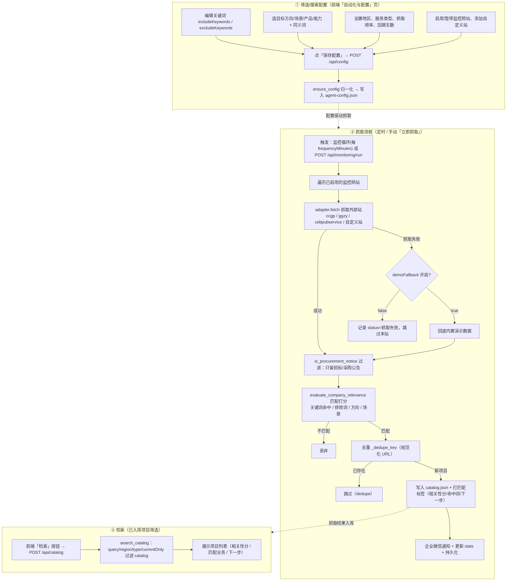

# 招标项目「筛选 / 抓取 / 检索」流程图与说明

## 一、整体流程图

## 二、分阶段说明

### ① 筛选/搜索配置（前端可直接改，无需改代码）

配置入口：**「自动化与配置」标签页**（`AutomationPage.vue`）。

| 配置项 | 字段 | 作用 |
|---|---|---|
| 搜索关键词 | `includeKeywords` | 命中这些词才纳入匹配 |
| 排除关键词 | `excludeKeywords` | 含这些词（中标/成交/废标公告等）直接排除 |
| 目标业务方向 | `targetDirections` | 匹配 BD-001/BD-002 等方向 |
| 目标场景/产品/能力 | `targetScenarios/Products/Capabilities` | 本体层面的匹配维度 |
| 同义词 | `synonyms` | 关键词扩展 |
| 地区 / 服务类型 | `region` / `serviceType` | 地域与服务面过滤 |
| 抓取频率 / 回溯天数 | `frequencyMinutes` / `lookbackDays` | 定时抓取节奏 |
| 24小时监控开关 | `enabled` | 是否开启定时抓取 |
| 监控网站 | `sites[]` | 启用/暂停/增删站点 |

保存链路：`保存配置` → `POST /api/config` → `update_configuration` → `ensure_config` 归一化 → `store.save_config` → 写回 `agent-config.json`。

### ② 抓取流程（定时 + 手动）

**触发**：定时（监控循环每 `frequencyMinutes` 分钟）或手动点「立即抓取」。

**核心步骤**（`tender_monitor/service.py` 的 `run_monitoring`）：

1. 遍历所有 `enabled` 的监控网站；
2. 每个站用对应 adapter 抓取（政府采购网 / 公共资源交易平台 / 招投标公共服务平台 / 自定义站）；
3. 抓取失败：记 `status=抓取失败`；若 `demoFallback=true` 则回退内置演示数据；
4. `is_procurement_notice` 过滤：只保留招标/采购公告；
5. `evaluate_company_relevance` 按配置做匹配打分（命中关键词、排除词、业务方向/场景等）；
6. 匹配命中后 `_dedupe_key`（规范化 URL）去重；
7. 新项目 `insert(0)` 写入 `catalog.json`，附带匹配标签；
8. 企业微信通知 + 更新 stats + 持久化。

### ③ 检索（已入库筛选，不访问外网）

点「检索」→ `POST /api/catalog` → `search_catalog`：在**已入库的 catalog** 里按 `query/region/type/currentOnly` 过滤，不重新抓取外网。

## 三、关键数据落点

| 数据 | 文件 |
|---|---|
| 筛选/搜索配置 | `agent-config.json` → `monitoring` |
| 抓取入库的项目 | `runtime/catalog.json` |
| 监控统计（累计/最新） | `agent-config.json` → `monitoring.stats` |
| M3 企业材料（匹配数据源） | M3 图库 `tenderhub` |
