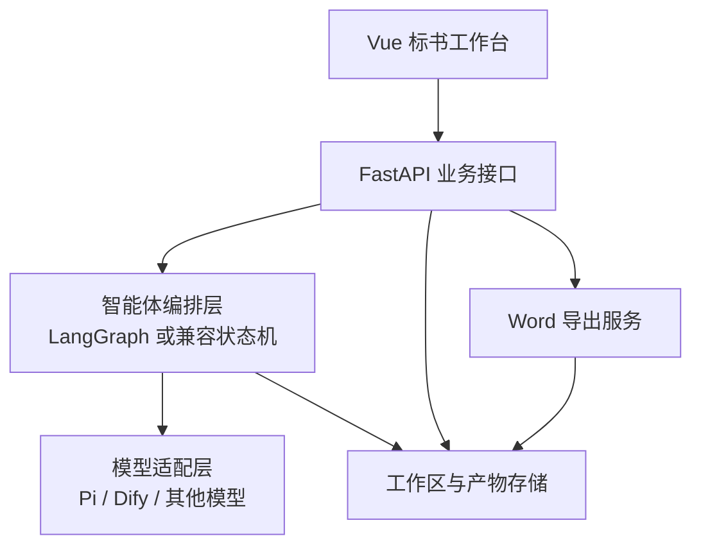

# 标书撰写智能体总体技术方案与实施计划

## 1. 文档目的

本文档是标书撰写模块的总体架构、数据契约和分阶段实施计划。

目标流程：

```text
上传招标文件
  -> 文件解析
  -> 项目信息/招标要求/评分办法/模板识别
  -> 解析质检
  -> 生成投标文件目录
  -> 条款与章节映射
  -> 企业素材匹配
  -> 章节提纲生成
  -> 章节正文撰写
  -> 模板、表格、图片填充
  -> 前端 Word-like 编辑
  -> 合规审查
  -> Word 导出
```

本计划遵循以下原则：

1. 每个智能体都有明确输入、输出和来源引用。
2. 所有解析供应方，包括本地规则、WorkBuddy、Pi、Dify，都归一化为同一套数据契约。
3. 智能体输出结构化 JSON，不能直接把不可追踪的长文本作为唯一结果。
4. 招标文件中的固定模板优先保留原始 Word 结构和样式，智能体只填充允许编辑的区域。
5. 所有阶段支持人工确认、失败回退和重新执行。
6. 原始文件、解析产物、智能体结果、人工编辑结果和最终导出文件分开保存。

---

## 2. 总体技术架构



### 2.1 技术组件职责

| 层级 | 推荐实现 | 主要职责 |
|---|---|---|
| 前端 | Vue 3 + TypeScript + Element Plus | 上传、确认、编辑、审查、导出 |
| 富文本编辑 | TipTap 或兼容 JSON 的编辑器 | 标题、段落、表格、图片、格式编辑 |
| API | FastAPI | 文件、任务、工作区、章节、审查、导出接口 |
| 编排层 | LangGraph 或当前项目兼容状态机 | 节点依赖、并行、重试、回退、人工确认 |
| 模型适配 | Pi Adapter、Dify Adapter | 屏蔽不同模型调用方式 |
| 文档解析 | python-docx、PDF 解析、OCR、表格解析 | 文本、段落、表格、图片、页码和样式定位 |
| 持久化 | 当前 JSON 文件，后续 SQLite/PostgreSQL | 运行状态、ParseBundle、工作区和版本 |
| Word 导出 | python-docx、docxtpl、OOXML | 保留模板结构并生成 DOCX |

---

## 3. 智能体与业务模块数量

第一版规划：

```text
14 个核心智能体
11 个核心业务模块
5 类核心中间产物
4 条主要编排流程
```

### 3.1 14 个核心智能体

#### 解析阶段：6 个

| 编号 | 智能体 | 功能 |
|---|---|---|
| P1 | `DocumentStructureAgent` | 识别招标文件章节、页码范围和文档层级 |
| P2 | `ProjectMetaAgent` | 抽取项目名称、编号、采购人、预算、截止时间等 |
| P3 | `RequirementExtractAgent` | 抽取资格、商务、技术、服务、交付、废标和附件要求 |
| P4 | `EvaluationExtractAgent` | 抽取评分办法、评分项、分值和得分关注点 |
| P5 | `TemplateDetectAgent` | 识别固定模板、章节骨架、表格、图片和可编辑区域 |
| P6 | `ParseReviewAgent` | 检查解析缺失、冲突、低置信度和需要人工确认的内容 |

#### 撰写阶段：8 个

| 编号 | 智能体 | 功能 |
|---|---|---|
| W1 | `OutlinePlanAgent` | 根据解析包生成投标文件目录 |
| W2 | `RequirementMapAgent` | 建立招标条款与投标章节的覆盖关系 |
| W3 | `MaterialMatchAgent` | 匹配企业证书、业绩、人员、案例和图片 |
| W4 | `SectionPlanAgent` | 为每个章节生成写作提纲和响应策略 |
| W5 | `SectionDraftAgent` | 根据条款、评分项、模板和企业素材撰写正文 |
| W6 | `TableFormFillAgent` | 填充投标函、偏离表、响应表、人员表等 |
| W7 | `VisualInsertAgent` | 规划架构图、证书、案例图片和表格的插入位置 |
| W8 | `ComplianceReviewAgent` | 检查漏项、评分点、格式、承诺边界和废标风险 |

### 3.2 11 个业务模块

| 编号 | 模块 | 功能 |
|---|---|---|
| M1 | 文件与原始材料模块 | 保存原始 PDF、Word、Excel、图片和文件版本 |
| M2 | 文档解析模块 | 提取段落、标题、表格、图片、页码和原始位置 |
| M3 | 模型适配模块 | 统一调用 Pi、Dify 或其他模型 |
| M4 | 智能体编排模块 | 管理节点顺序、并行、重试、回退和人工确认 |
| M5 | ParseBundle 模块 | 保存解析阶段的统一结构化产物 |
| M6 | 模板与 Word 片段模块 | 保存招标模板、表格、图片、样式和可编辑区域 |
| M7 | 企业素材库模块 | 管理证书、业绩、人员、案例、产品资料和图片 |
| M8 | 标书工作区模块 | 管理目录、章节、版本、状态和人工修改 |
| M9 | EditableDocumentBlocks 模块 | 统一表示标题、段落、表格、图片和附件块 |
| M10 | 审查与操作记录模块 | 保存审查报告、风险项、人工确认和修改记录 |
| M11 | Word 导出模块 | 按模板和编辑结果生成 DOCX 文件 |

---

## 4. 四条主要编排流程

### 4.1 ParseGraph：解析编排

```text
文件接收
  -> 文本/版面解析
  -> 文档结构识别
  -> 项目信息抽取
  -> 招标要求抽取
  -> 评分办法抽取
  -> 模板识别
  -> 解析质检
  -> ParseBundle
```

其中项目基本信息、招标要求、评分办法和模板识别可以在文档结构完成后并行执行。

### 4.2 WritingGraph：撰写编排

```text
ParseBundle
  -> 目录规划
  -> 条款-章节映射
  -> 企业素材匹配
  -> 章节写作计划
  -> 章节正文撰写
  -> 表格/模板填充
  -> 图文素材插入规划
  -> EditableDocumentBlocks
```

目录生成后必须允许人工确认。确认后的目录才作为后续章节撰写的正式输入。

### 4.3 ReviewGraph：审查编排

```text
EditableDocumentBlocks
  + RequirementSet
  + EvaluationSet
  + BidFormatSpec
  -> ComplianceReviewAgent
  -> 风险项和修改建议
  -> 人工修订
  -> 再审查
```

### 4.4 ExportFlow：导出流程

```text
人工确认后的 EditableDocumentBlocks
  + Word 样式模板
  + 项目信息
  -> WordExportService
  -> DOCX
  -> 导出记录和文件版本
```

---

## 5. 标准中间产物

### 5.1 `ParseBundle`

一次招标文件解析完成后的标准数据包。

```json
{
  "parseBundleId": "parse-001",
  "schemaVersion": "1.0",
  "provider": "pi",
  "status": "completed",
  "projectId": "project-001",
  "workspaceId": "workspace-001",
  "sourceFile": {},
  "documentBlocks": {},
  "documentStructure": {},
  "projectMeta": {},
  "requirements": [],
  "evaluationItems": [],
  "bidFormatSpec": {},
  "templateFragments": [],
  "templateFragmentsArtifact": "",
  "rawOutline": [],
  "riskItems": [],
  "parseReviewReport": {},
  "artifacts": [],
  "warnings": [],
  "agentResults": [],
  "rawProviderResult": {}
}
```

`ParseBundle` 是解析阶段的总容器，不要求所有智能体输出相同字段。每个智能体写入自己的标准子结构。

### 5.2 `AgentResultEnvelope`

所有智能体结果使用统一外壳：

```json
{
  "runId": "agent-run-001",
  "agentId": "RequirementExtractAgent",
  "provider": "pi",
  "model": "",
  "status": "success",
  "inputRefs": [
    "parse:documentBlocks"
  ],
  "output": {},
  "sourceRefs": [
    {
      "page": 42,
      "blockId": "block-240",
      "text": "投标人应提供完整技术方案"
    }
  ],
  "warnings": [],
  "confidence": 0.92,
  "createdAt": "2026-09-21T10:00:00+08:00",
  "finishedAt": "2026-09-21T10:00:05+08:00"
}
```

### 5.3 `BidOutlinePlan`

```json
{
  "planSource": "pi_agent",
  "sections": [
    {
      "sectionId": "sec-001",
      "title": "技术方案",
      "kind": "technical",
      "source": "tender_template",
      "templateId": "tpl-001",
      "requirementIds": ["req-001"],
      "evaluationIds": ["eval-001"]
    }
  ],
  "warnings": []
}
```

### 5.4 `RequirementCoverageMap`

```json
{
  "coverage": [
    {
      "requirementId": "req-001",
      "sectionId": "sec-001",
      "coverageType": "chapter_text",
      "status": "planned"
    }
  ],
  "uncoveredRequirements": [],
  "duplicatedRequirements": []
}
```

### 5.5 `EditableDocumentBlocks`

```json
{
  "sections": [
    {
      "sectionId": "sec-001",
      "title": "技术方案",
      "source": "tender_template",
      "templateId": "tpl-001",
      "blocks": [
        {
          "blockId": "block-001",
          "type": "heading",
          "level": 1,
          "text": "技术方案",
          "locked": true
        },
        {
          "blockId": "block-002",
          "type": "paragraph",
          "text": "本项目建设目标为……",
          "locked": false
        },
        {
          "blockId": "block-003",
          "type": "table",
          "tableId": "table-001"
        },
        {
          "blockId": "block-004",
          "type": "image",
          "materialId": "img-001"
        }
      ]
    }
  ]
}
```

---

## 6. 智能体输入输出规划

### 6.1 解析阶段

| 智能体 | 输入 | 输出 | 下游 |
|---|---|---|---|
| `DocumentStructureAgent` | `documentBlocks` | `documentStructure` | 所有解析智能体 |
| `ProjectMetaAgent` | `documentBlocks + documentStructure` | `projectMeta` | 目录、正文、封面、投标函 |
| `RequirementExtractAgent` | `documentBlocks + documentStructure` | `requirements` | 目录、映射、素材、正文、审查 |
| `EvaluationExtractAgent` | `documentBlocks + documentStructure` | `evaluationItems` | 目录、正文、审查 |
| `TemplateDetectAgent` | `documentBlocks + documentStructure` | `bidFormatSpec` | 目录、模板填充、导出 |
| `ParseReviewAgent` | 以上解析产物 | `parseReviewReport` | 前端确认、编排决策 |

### 6.2 撰写阶段

| 智能体 | 输入 | 输出 | 下游 |
|---|---|---|---|
| `OutlinePlanAgent` | `ParseBundle` | `BidOutlinePlan` | 人工确认、条款映射 |
| `RequirementMapAgent` | `BidOutlinePlan + requirements` | `RequirementCoverageMap` | 素材匹配、章节计划 |
| `MaterialMatchAgent` | `RequirementCoverageMap + 企业素材库` | `MaterialMatchResult` | 章节写作、附件生成 |
| `SectionPlanAgent` | 章节 + 条款 + 评分项 + 模板 + 素材 | `SectionWritingPlan` | 正文撰写 |
| `SectionDraftAgent` | `SectionWritingPlan + ParseBundle + 素材` | `SectionDraft` | 文档块转换 |
| `TableFormFillAgent` | `bidFormatSpec + projectMeta + 企业信息` | `GeneratedTables` | 文档块转换、导出 |
| `VisualInsertAgent` | `SectionDraft + MaterialMatchResult` | `VisualInsertPlan` | 文档块转换 |
| `ComplianceReviewAgent` | 编辑后文档 + 解析产物 | `ComplianceReviewReport` | 前端风险提示、返工 |

---

## 7. 模板复用原则

招标文件中的模板分为三种：

| 类型 | 处理方式 |
|---|---|
| `fixed_template` | 原样复制，只填充字段 |
| `template_plus_ai` | 保留标题、表格和样式，智能体填充可编辑区域 |
| `ai_generated` | 招标文件没有可用模板，由智能体生成 |

模板必须同时保存：

```text
原始 DOCX 文件
模板来源位置
模板结构化 blocks
可编辑字段
锁定字段
模板片段文件
```

禁止只保留纯文本。否则会丢失字体、表格边框、合并单元格、图片、分页符、页眉页脚和签章位置。

---

## 8. API 规划

### 8.1 解析接口

| 方法 | 路径 | 功能 |
|---|---|---|
| POST | `/api/bid-runs` | 上传文件并创建解析任务 |
| GET | `/api/bid-runs/{runId}` | 查询解析状态和运行来源 |
| POST | `/api/bid-runs/{runId}/materialize` | 将解析包写入工作区 |
| GET | `/api/workspaces/{workspaceId}/parse-bundle` | 查看标准解析包 |

### 8.2 目录接口

| 方法 | 路径 | 功能 |
|---|---|---|
| POST | `/api/workspaces/{workspaceId}/bid-document/plan` | 生成目录 |
| PUT | `/api/workspaces/{workspaceId}/bid-document/plan` | 保存人工修改后的目录 |
| GET | `/api/workspaces/{workspaceId}/coverage` | 查看条款与章节映射 |

### 8.3 撰写接口

| 方法 | 路径 | 功能 |
|---|---|---|
| POST | `/api/workspaces/{workspaceId}/bid-document/sections/{sectionId}/generate` | 一键生成章节 |
| PUT | `/api/workspaces/{workspaceId}/bid-document/sections/{sectionId}` | 保存章节编辑结果 |
| POST | `/api/workspaces/{workspaceId}/bid-document/sections/{sectionId}/fill-template` | 使用招标模板填充章节 |

### 8.4 审查和导出接口

| 方法 | 路径 | 功能 |
|---|---|---|
| GET | `/api/workspaces/{workspaceId}/proofread` | 读取或执行基础审查 |
| POST | `/api/workspaces/{workspaceId}/compliance-review` | 执行智能体合规审查 |
| POST | `/api/workspaces/{workspaceId}/bid-document/export` | 导出 DOCX |

---

## 9. 数据存储规划

当前阶段继续兼容 JSON 存储，目录如下：

```text
runtime/
  bid_runs.json
  workspaces.json
  catalog.json
  projects/
    <projectId>/
      source/
        原始招标文件
      parse/
        parse-bundle.json
        agent-results/
        document-blocks.json
        template-fragments/
      outputs/
        最终投标文件.docx
        最终投标文件.json
```

工作区只保存解析包引用，不重复塞入全部解析内容：

```json
{
  "parseBundleRef": {
    "parseBundleId": "parse-001",
    "schemaVersion": "1.0",
    "provider": "pi",
    "artifact": "runtime/projects/project-001/parse/parse-bundle.json"
  }
}
```

---

## 10. 分阶段实施计划

### 阶段 0：统一数据契约和解析包

目标：建立所有后续智能体共同使用的标准输入输出基础。

任务：

- [x] 新增 `ParseBundle` 标准模型。
- [x] 新增 `AgentResultEnvelope` 统一结果外壳。
- [x] 新增解析包构建、校验、保存和读取方法。
- [x] Pi/Dify 解析任务保存 `provider`、`parseBundleId` 和解析包文件位置。
- [x] 云端解析物化时写入 `parseBundleRef`。
- [x] 增加查看解析包的后端接口。
- [x] 保持旧的 `result`、`cloudParse`、`reasoning` 字段兼容。
- [x] 补充契约测试和现有回归测试。

阶段 0 完成时间：2026-09-21。

验收标准：

```text
同一次解析任务可以明确知道 provider。
runtime/projects/<projectId>/parse/parse-bundle.json 存在。
ParseBundle 能被 Pydantic 校验并重新读取。
已有目录生成和章节生成测试全部通过。
旧工作区没有 ParseBundle 时不会崩溃。
```

### 阶段 1：解析智能体链路

目标：把当前解析结果拆分为可独立验证的解析产物。

任务：

- [x] 统一 `DocumentBlocks`。
- [x] 接入 `DocumentStructureAgent`。
- [x] 接入 `ProjectMetaAgent`。
- [x] 接入 `RequirementExtractAgent`。
- [x] 接入 `EvaluationExtractAgent`。
- [x] 接入 `TemplateDetectAgent`。
- [x] 接入 `ParseReviewAgent`。
- [x] 前端展示解析来源和子智能体执行状态。

阶段 1 当前实现：

```text
PiParseOrchestrator
  -> DocumentStructureAgent
  -> ProjectMetaAgent
  -> RequirementExtractAgent
  -> EvaluationExtractAgent
  -> TemplateDetectAgent
  -> ParseReviewAgent
  -> ParseBundle
```

每个节点的结果都会写入 `AgentResultEnvelope`，单个节点失败时继续执行并记录告警；全部节点失败时任务失败。

### 阶段 2：目录和条款覆盖

目标：目录不只是章节列表，还能显示每章覆盖哪些招标要求。

任务：

- [x] `OutlinePlanAgent` 只读取 `ParseBundle`。
- [x] 接入 `RequirementMapAgent`。
- [x] 目录支持模板来源标识。
- [x] 支持人工确认和保存目录。
- [x] 保存未覆盖条款、重复覆盖条款和节点轨迹。

阶段 2 当前实现：

```text
ParseBundle
  -> OutlinePlanAgent
  -> RequirementMapAgent
  -> BidOutlinePlan + RequirementCoverageMap
  -> 人工编辑/保存目录
```

目录生成接口仍然保持原路径不变。Pi 编排结果写入 `bidDocument.plan`、`bidDocument.requirementCoverage`、`bidDocument.uncoveredRequirements`、`bidDocument.duplicatedRequirements` 和 `bidDocument.agentResults`。

当前阶段验收边界：

1. 目录规划和条款映射已经通过本地 fake Pi 测试，未在测试中真实调用 Pi CLI。
2. 没有有效 Pi 目录时，现有本地规则仍会回退，避免历史工作区不可用。
3. 目录确认后，技术章节可以继续进入阶段 4 的 Pi 三节点章节编排。

### 阶段 3：模板复用

目标：招标文件已有模板时，尽量原样复制并保留 Word 样式。

任务：

- [x] 模板片段抽取和落盘。
- [x] 固定字段识别。
- [x] 模板章节绑定目录章节。
- [x] `TableFormFillAgent` 使用 Pi 填充固定表格。
- [x] DOCX 原始 body 片段复制、样式保留和图片关系重映射。

阶段 3 当前实现：

```text
ParseBundle.bidFormatSpec.templates
  -> TemplateFragment
  -> template-fragments/*.json
  -> 目录章节 templateFragmentId
  -> TableFormFillAgent
  -> 确定性字段/单元格填充
  -> DOCX OOXML 片段复制
```

当前边界：

1. 只有 DOCX 支持原始 OOXML body 范围复制，其他格式回退为文本渲染。
2. 无可靠来源的字段保留空位并进入 `blanksToFill`，不会由 Pi 猜测。
3. 页眉页脚、复杂跨文档关系、Word 内容控件和结构化富文本编辑器继续后续实现。

### 阶段 4：章节一键填充

目标：正文编辑页可以按章节生成可编辑正文。

任务：

- [x] `MaterialMatchAgent`。
- [x] `SectionPlanAgent`。
- [x] `SectionDraftAgent`。
- [x] Pi 章节撰写来源标识。
- [x] 章节内容、要求和来源引用关联。
- [x] 支持单章重新生成。
- [x] `SectionRewriteAgent` 支持本章补写/重写。

阶段 4 当前实现：

```text
ParseBundle
  + RequirementCoverageMap
  + 企业画像与 M3 材料
  -> MaterialMatchAgent
  -> SectionPlanAgent
  -> SectionDraftAgent
  -> BidSection.content + sourceRefs + writingPlan + agentResults
```

材料匹配失败时会记录失败节点并继续生成计划；正文节点没有有效内容时触发现有本地生成回退。

本轮新增局部修改链路：

```text
已有 BidSection
  + 用户修改要求
  -> SectionRewriteAgent
  -> 确定性应用器（append / rewrite / replace_selection）
  -> BidSection.content + editHistory + rewriteSourceRefs
```

固定模板章节不会进入局部重写链路，只能使用 `TableFormFillAgent` 或人工编辑可填字段。

### 阶段 5：结构化正文编辑

目标：从纯文本编辑升级为 Word-like 编辑。

任务：

- [ ] `EditableDocumentBlocks`。
- [ ] TipTap 或其他结构化编辑器。
- [ ] 标题、段落、列表、表格、图片和附件块。
- [ ] 模板锁定区域和可编辑区域。
- [x] 局部修改的轻量 `editHistory` 记录。

### 阶段 6：审查和 Word 导出

目标：导出前发现漏项和格式风险，生成可交付 DOCX。

任务：

- [x] `ComplianceReviewAgent`。
- [x] 评分项覆盖率。
- [x] 强制条款覆盖率。
- [ ] 模板格式检查。
- [x] Word 导出基础链路。
- [x] 固定模板章节优先复制原始 DOCX，失败时返回告警并回退文本。
- [ ] 导出文件版本和审查报告绑定。

### 阶段 7：数据库和生产化

目标：从本地 JSON 迁移到可并发、可追踪的生产存储。

任务：

- [ ] SQLite/PostgreSQL 数据模型。
- [ ] 文件对象存储。
- [ ] 异步任务队列。
- [ ] 用户和权限。
- [ ] 智能体运行日志和成本统计。
- [ ] 并发任务、重试和超时治理。

---

## 11. 当前阶段：阶段 4 延伸与阶段 6 首批

阶段 0、阶段 1、阶段 2 已完成；阶段 3 模板复用首批已完成；阶段 4 单章 Pi 编排和局部修改首批已接入；阶段 6 合规审查首批已接入。

### 11.1 后端代码

- `backend/app/agent_runtime/contracts.py`
  - `AgentResultEnvelope`
  - `ParseBundle`
  - `build_parse_bundle`
  - `build_agent_result`
- `backend/app/agent_runtime/__init__.py`
- `backend/app/cloud_agent/run_service.py`
  - 保存 `provider`
  - 保存 `parseBundleId`
  - 保存 `parseBundleArtifact`
  - 写入 `parse-bundle.json`
- `backend/app/store.py`
  - 保存和读取解析包
  - 云端解析物化时生成 `parseBundleRef`
  - 目录规划接入 `OutlinePlanAgent` 和 `RequirementMapAgent`
  - 单章撰写接入 `MaterialMatchAgent`、`SectionPlanAgent`、`SectionDraftAgent`
  - 局部修改接入 `SectionRewriteAgent`
  - 确定性基础校对与 `ComplianceReviewAgent` 结果合并落盘
- `backend/app/bid_writing/compliance.py`
  - 要求、强制项和评分项覆盖率计算
- `backend/app/api/bid_writing.py`
  - 增加读取解析包接口
- `backend/app/pi_agent/writing_orchestrator.py`
  - 目录和条款覆盖编排
  - 单章材料匹配、写作计划和正文编排
  - `TableFormFillAgent` 模板字段和表格填充编排
  - `SectionRewriteAgent` 局部补写/重写编排
  - `ComplianceReviewAgent` 合规审查编排
- `backend/app/bid_writing/template_fragments.py`
  - 模板片段标准结构
  - DOCX body 范围定位
  - 模板片段索引和目录绑定
- `backend/app/bid_writing/template_reuse.py`
  - 确定性字段填充
  - 固定表格单元格填充
- `backend/app/bid_writing/assemble.py`
  - 原始模板片段复制
  - 图片关系重映射
  - 复制失败告警和文本回退

### 11.2 测试

- ParseBundle 最小结构校验。
- AgentResultEnvelope 来源和状态校验。
- Pi 解析任务产物落盘。
- 云端解析物化保存 `parseBundleRef`。
- 旧目录和章节生成回归。
- Pi 三节点章节编排顺序和失败回退测试。
- 模板片段绑定、Pi 表单填充和 DOCX 导出回归。
- Pi 局部修改、模板保护、编辑轨迹和合规审查回归。

### 11.3 本阶段不做

- 不新增完整 LangGraph 运行时。
- 不替换现有富文本编辑器。
- 不接入复杂的多轮合规修复闭环；当前审查只输出风险，不自动改正文。
- 不删除 `cloudParse`、`reasoning` 和旧字段。

---

## 12. 当前代码到目标架构的映射

| 当前代码 | 目标位置 |
|---|---|
| `backend/app/pi_agent/client.py` | Pi 模型适配模块 |
| `backend/app/pi_agent/prompts.py` | Pi 智能体提示词 |
| `backend/app/pi_agent/orchestrator.py` | 解析阶段 Pi 编排 |
| `backend/app/pi_agent/writing_orchestrator.py` | 目录、条款覆盖和章节撰写 Pi 编排 |
| `backend/app/cloud_agent/run_service.py` | 解析任务和编排入口 |
| `backend/app/cloud_agent/materializer.py` | 解析结果兼容物化 |
| `backend/app/store.py` | 当前工作区业务服务，后续逐步拆分 |
| `backend/app/bid_writing/schemas.py` | 标书目录和章节契约 |
| `frontend/src/features/bid-workspace/BidWritingPage.vue` | 上传、目录和正文工作台 |
| `runtime/projects/*/source` | 原始文件 |
| `runtime/projects/*/parse` | 标准解析包和解析阶段产物 |
| `runtime/projects/*/outputs` | Word 和其他导出结果 |

---

## 13. 当前阶段完成后的下一步

阶段 4 局部补写和阶段 6 合规审查首批已完成，下一步进入结构化正文编辑与图片/附件插入：

```text
已有章节正文
  -> EditableDocumentBlocks
  -> VisualInsertAgent
  -> ComplianceReviewAgent（二次审查）
```

每接入一个智能体，都必须补充：

```text
输入 Schema
输出 Schema
提示词
来源引用
失败回退
单元测试
前端展示或调试入口
```

---

## 14. 本阶段真实验证结果（2026-09-21）

本阶段已在当前本机工作区 `workspace-workbuddy-sxq` 上完成一次真实链路验证。该工作区原先由旧版流程创建，没有独立 `ParseBundle`，系统先从已有本地文档结构、`fineReview` 和评分结果生成兼容解析包，并明确标记：

```text
provider = legacy_local
status = compatibility
```

这一步只是兼容迁移，不代表旧数据曾经调用过 Pi。

### 14.1 目录规划真实结果

重新执行目录规划后，实际结果为：

```text
planSource = pi_agent
planCount = 51
coverage = 122 条要求
uncoveredRequirements = 0
agentResults =
  OutlinePlanAgent: success
  RequirementMapAgent: success
```

本次目录规划根据原招标文件的技术参数和商务要求生成了技术章节，例如：

```text
t-01 数字孪生应用开发平台技术参数逐项响应资料
t-02 场景管理响应资料
t-03 孪生体管理响应资料
t-04 图层管理响应资料
t-05 业务管理响应资料
...
```

旧版评分项中存在缺少稳定 `id` 的记录，因此 Pi 没有伪造 `evaluationIds`，而是在 `planningWarnings` 中明确提示评分关联需要人工复核。

### 14.2 单章节真实结果

对 `t-02 场景管理响应资料` 执行单章生成后，实际调用链为：

```text
MaterialMatchAgent
  -> SectionPlanAgent
  -> SectionDraftAgent
  -> Store._fill_bid_section
```

实际结果：

```text
draftProvider = pi
provider = pi
phase = section_draft
status = needs_review
contentLength ≈ 9263
materialMatches = 106
unmatchedMaterialRequirementIds = 106
```

三个节点状态：

```text
MaterialMatchAgent: success
SectionPlanAgent: failed（Pi 单次调用超时）
SectionDraftAgent: success
```

由于当前 M3 企业材料中部分技术资料缺少 `id`、`factId`、`materialId` 或 `evidenceId`，系统没有把仅有名称的材料当成可引用证据，最终正文追加：

```text
【需人工补充：缺少具体资料】
```

因此本次章节被标记为 `needs_review`，而不是误标为完全生成或已满足。

### 14.3 本阶段修复项

1. Windows 下 `pi.cmd` 通过 Python 子进程启动时会出现 `WinError 5`；现在 `.cmd/.bat` 会通过 `COMSPEC /d /c` 启动，`.ps1` 会通过 PowerShell 启动。
2. 旧版工作区缺少 `ParseBundle` 时，会生成 `legacy_local` 兼容包并落盘。
3. 已存在解析包但工作区缺少 `parseBundleRef` 时，读取解析包会自动补齐引用，保证前端能显示解析来源。
4. `SectionPlanAgent` 漏掉当前章节要求或评分项时，编排器会补入 `needs_review` 占位项。
5. 存在未匹配或部分匹配材料、但正文没有人工补充标记时，编排器会追加人工补充标记并把章节状态改为 `needs_review`。
6. 旧持久化数据中如果已有 Pi 目录、但 `requirementCoverage` 丢失，后端会根据章节 `requirementIds` 与固定资格/商务章节确定性回填，不重新调用模型。

### 14.4 当前边界和下一步

当前真实链路已经证明“目录生成”和“单章节生成”可以通过 Pi 编排接入现有 FastAPI。下一步按优先级处理：

1. 给 M3 企业材料补齐稳定的事实 ID 和证据 ID，减少合法材料被误判为待补。
2. 将 `SectionPlanAgent` 的输入进一步裁剪为当前章节要求和评分项，降低超时概率。
3. 增加章节级超时、重试和阶段耗时记录，前端显示具体失败节点。
4. 继续实现结构化正文块、图片/附件插入和二次 `ComplianceReviewAgent` 审查。
