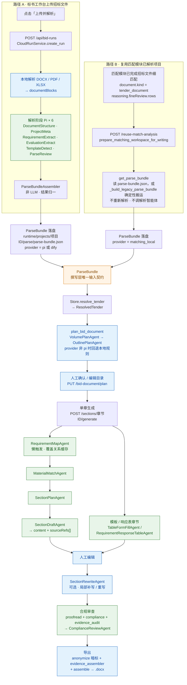

# 标书撰写端到端链路与智能体清单

> 盘点基准：当前工作区代码（`backend/app/`、`frontend/src/`），非规划文档。
> 覆盖范围：标书工作台的两条进入路径、全部参与标书撰写的智能体与确定性模块、前端按钮到后端调用的完整映射。
> 相关文档：[当前 PI 智能体清单与流程](./当前PI智能体清单与流程.md)、[标书撰写智能体总体技术方案与实施计划](./标书撰写智能体总体技术方案与实施计划.md)。

---

## 0. 结论先看

1. 标书工作台有**两条进入路径**：①「上传并解析」新招标文件；②「复用评估结果」选择匹配模块已解析过的项目。
2. 两条路径**只在解析阶段不同**，在 `ParseBundle` 处汇合；`bidDocument.plan` 生成之后的所有环节**完全共用同一套代码**。
3. 当前共接入 **16 个 Pi 逻辑智能体**（解析 6 + 规划 3 + 单章撰写 3 + 模板表格 2 + 局部修改 1 + 审查 1），加上 **21 个确定性模块**（`bid_writing/` 包，多数不调 LLM）。
4. 「智能体」在当前架构里是**提示词 + JSON 输出规范**，不是常驻服务；由 Python 编排器控制顺序，每次调用启动一次 `pi --mode rpc` 子进程，未使用 LangGraph。
5. 前端真正挂按钮的页面只有 `BidWritingPage.vue`（`App.vue` 中的 `activeTab === "workspace"`）；`BidWorkspacePage.vue` / `BidGeneratorPage.vue` 未被挂载，属历史页面。

---

## 1. 总体分层

```text
┌─────────────────────────── 前端 Vue 3 工作台 ───────────────────────────┐
│ BidWritingPage.vue（App.vue: activeTab === "workspace"）                │
│   第一步 选择已有项目 / 上传新招标文件                                    │
│   第二步 目录编辑 + 单章撰写                                             │
│   第三步 合规审查 + 导出 Word                                            │
└───────────────────────────────┬─────────────────────────────────────────┘
                                │ HTTP /api（见第 6 节映射表）
┌───────────────────────────────▼─────────────────────────────────────────┐
│ FastAPI 路由层                                                          │
│   api/bid_writing.py   plan / generate / generate-section / fill /      │
│                        rewrite / save / export / proofread /            │
│                        compliance-review / reuse-match-analysis         │
│   api/cloud_agent.py   /api/bid-runs（上传解析任务）                     │
│   main.py              /api/import 等                                  │
└───────────────────────────────┬─────────────────────────────────────────┘
                                ▼
┌─────────────────────────────────────────────────────────────────────────┐
│ Store 业务门面（backend/app/store.py）                                   │
│  get_parse_bundle / prepare_matching_workspace_for_writing /             │
│  resolve_tender / plan_bid_document / generate_bid_section /             │
│  generate_bid_document / fill_bid_section_template /                     │
│  rewrite_bid_section / proofread_workspace / compliance_review_workspace │
│  export_bid_document                                                     │
└───────────────┬─────────────────────────────────┬───────────────────────┘
                ▼                                 ▼
┌───────────────────────────────┐  ┌──────────────────────────────────────┐
│ ① Pi 逻辑智能体（LLM）         │  │ ② 确定性模块（bid_writing/ 包）        │
│ 编排器：                       │  │ 无 LLM 的结构规划 / 表格化 / 偏离表 /  │
│  PiParseOrchestrator           │  │ 组装导出 / 校对，同时是 Pi 失败时的回退 │
│  PiWritingOrchestrator         │  │                                      │
│ 调用：pi_agent/client.py       │  │                                      │
│ 提示词：pi_agent/prompts.py    │  │                                      │
└───────────────┬────────────────┘  └──────────────────┬───────────────────┘
                └──────────────┬───────────────────────┘
                               ▼
                    共享契约
                    bid_writing/schemas.py
                    agent_runtime/contracts.py（AgentResultEnvelope / ParseBundle）
                               ▼
                    runtime/ 本地运行数据（见第 7 节）
```

### 1.1 端到端总览图（Mermaid 可渲染）



> 图例：绿色 = Pi 逻辑智能体（LLM），蓝色 = 确定性模块（无 LLM），橙色 = 两条路径的汇合点。
> 两条路径在 `ParseBundle` 汇合，其后所有环节共用同一套代码。

---

## 2. 两条路径的端到端链路

### 2.1 路径 A：标书工作台「上传并解析」新招标文件

```text
【前端】第一步「上传并解析」按钮 → startImport() → startCloudParse()
   │  api.createBidRun(file)                      POST /api/bid-runs（202）
   ▼
【后端】CloudRunService.create_run() → 落盘 runtime/projects/<pid>/runs/<runId>/
   │  BackgroundTasks → process_run(runId)
   ▼
① 本地解析：DOCX / PDF / XLSX → segments / units / tables / sections / text
   │  （tender_matching/document_parser.py 等）
   ▼
② 解析阶段 · Pi × 6（PiParseOrchestrator，orchestrator.py:869）
     DocumentStructureAgent   → documentStructure.sections[]
     ProjectMetaAgent         → projectMeta
     RequirementExtractAgent  → requirements[]        （本地规则候选 + Pi 合并去重）
     EvaluationExtractAgent   → evaluationItems[]
     TemplateDetectAgent      → bidFormatSpec / submissionStructure / rawOutline / templateFragments
     ParseReviewAgent         → parseReviewReport + riskItems
   │  ParseBundleAssembler（非 LLM）归一
   ▼
③ ParseBundle 落盘
     runtime/projects/<pid>/parse/parse-bundle.json
     runtime/projects/<pid>/parse/template-fragments/*.json
   │  run 状态 → outline_ready / completed
   ▼
【前端】轮询 GET /api/bid-runs/{runId} → materializeBidRun()
   │  POST /api/bid-runs/{runId}/materialize
   ▼
【后端】Store.materialize_cloud_parse(run)
   → 创建/更新 project（dataOrigin = "cloud_agent"，document.kind = "tender_document"）
   → 创建 workspace，写 parseBundleRef
   ▼
════════════════ 汇合点：ParseBundle + workspace ════════════════
   ↓（以下与路径 B 完全相同）
```

### 2.2 路径 B：标书工作台「复用评估结果并生成目录」选择已解析项目

```text
【匹配模块】公告发现 → 招标文件解析 → 公告粗匹配 + 招标文件细匹配
     → 落盘 workspace.project.document.{sections,tables,segments,units,text}
     → 落盘 workspace.project.parsed.{projectName,budgetAmount,bidDeadline,…}
     → 落盘 workspace.reasoning.fineReview.rows
     → workspace.project.document.kind = "tender_document"

【前端】第一步历史项目列表按钮「复用评估结果并生成目录」
   │  runHistoryAction() → reuseMatchingWorkspace()
   │  （前置判定：project.document.kind === "tender_document" 且 fineReview.rows 非空）
   ▼
① POST /api/workspaces/{workspaceId}/reuse-match-analysis
   └─ Store.prepare_matching_workspace_for_writing(workspace_id)
      ├─ 校验 document.kind === "tender_document" 且 fineReview.rows 非空
      │    否则返回 None → HTTP 409「该项目没有可复用的完整招标文件匹配评估结果」
      ├─ parse_bundle = Store.get_parse_bundle(workspace_id)
      │    ├─ 已有 parse-bundle.json → 直接读取（并做 submissionStructure 修正、
      │    │   templateFragments 刷新、parseBundleRef 补齐）
      │    └─ 无 → Store._build_legacy_parse_bundle()  ← 确定性搬运，不调任何智能体
      │          provider = "matching_local"（kind==tender_document）或 "legacy_local"
      └─ 返回 { workspace, parseBundle, parseSource }
   ▼
② POST /api/workspaces/{workspaceId}/bid-document/plan
   └─ Store.plan_bid_document(workspace_id)     ← 与路径 A 同一个方法
   ▼
════════════════ 汇合点：bidDocument.plan 生成 ════════════════
```

**关键点：该路径不读取、不重新解析源文件，不调用任何解析智能体。**
`prepare_matching_workspace_for_writing` 的 docstring 明确写了：*never reads or reparses the uploaded source file and never invokes a parse agent*。

### 2.3 `_build_legacy_parse_bundle` 字段级搬运表（路径 B 专用）

| ParseBundle 字段 | 来源 | 兜底 |
|---|---|---|
| `provider` | `kind == "tender_document"` → `matching_local`；否则 `legacy_local` | — |
| `status` | `"compatibility"` | — |
| `parseBundleId` | `parse-legacy-{workspaceId}` | — |
| `agentResults` | `[]`（未跑过解析智能体） | — |
| `requirements[]` | `fineReview.rows` | `parsed.requirements` |
| `evaluationItems[]` | `reasoning.evaluation.items` | `cloudParse.evaluationItems` → 否则 `eval_parser.parse_eval_items(sections, tables)` |
| `documentBlocks` | `{text, segments, units, tables, sections, warnings}` | text ← `project.analysisText` / `parsed.rawText` / `document.text` |
| `documentStructure.sections` | `document.sections` 原样 | warnings ← `document.structureWarnings` |
| `projectMeta` | `parsed.*` → `project.*`（明细见下） | — |
| `bidFormatSpec` | `cloudParse.bidFormatSpec` | `{}` |
| `submissionStructure` | `cloudParse.submissionStructure` | `parse_submission_format_tree(analysisText)` 本地重推 |
| `templateFragments` | `cloudParse.templateFragments` | — |
| `rawOutline` | `cloudParse.outline` | — |
| `riskItems` | `cloudParse.riskItems` | `fineReview.risks` |
| `parseReviewReport` | 固定 `{status:"compatibility", warnings:[…]}` | — |

`projectMeta` 字段搬运：

| ParseBundle.projectMeta | 来源 |
|---|---|
| `projectName` | `parsed.projectName` → `project.title` |
| `projectCode` | `parsed.projectCode` → `project.projectCode` |
| `tendererName` | `parsed.tendererName` → `project.tendererName` |
| `agencyName` | `parsed.agencyName` → `project.agencyName` |
| `budget` | `parsed.budgetAmount` → `project.budget` |
| `deadline` | `parsed.bidDeadline` → `project.bidDeadline` |
| `servicePeriod` | `parsed.servicePeriod` → `project.servicePeriod` |
| `serviceLocation` | `parsed.serviceLocation` → `project.region` |

### 2.4 汇合后的公共链路（两条路径完全一致）

```text
ParseBundle
  ↓  Store.plan_bid_document()                      POST /bid-document/plan
  │
  ├─ Store.resolve_tender()  → ResolvedTender（resolved_input.py）
  │     ├─ eval      ← parse_bundle.evaluationItems / eval_parser
  │     ├─ composition ← outline.extract_response_outline
  │     ├─ requirements ← fineReview.rows / parse_bundle.requirements
  │     └─ projectMeta / company / organization / knowledge / risk / summary
  ├─ bidDocument.evaluationPlan = planning.plan_from_eval(eval.items)
  ├─ Store._plan_bid_document_with_pi()
  │     ├─ provider == "pi"  → VolumePlanAgent → OutlinePlanAgent
  │     └─ provider != "pi"  → not_attempted，回退本地规则：
  │            plan_from_outline → plan_from_eval → complete_fallback_plan
  │            → minimal_bid_skeleton
  ├─ template_fragments.attach_template_fragments_to_plan()
  ├─ volumes.arrange_volumes(plan, submissionStructure)
  ├─ response_table.bind_response_table_requirements(plan, fine_review)
  ├─ deviations.build_deviation_tables(fine_review)   ← 只读 fineReview.rows，不调 LLM
  ├─ evaluation_strategy.attach_evaluation_strategy() → 每章分值权重/深度档位
  ├─ section_blueprints.attach_section_blueprints()   → 每章写作蓝图
  └─ bidDocument 落盘（workspace.bidDocument → runtime/workspaces.json）
  ↓  人工确认/编辑目录 → PUT /bid-document/plan（Store.save_bid_plan，不调智能体）
  ↓
  Store.generate_bid_section(section_id)            POST /sections/{id}/generate
  ├─ Store._ensure_pi_requirement_coverage()  ← RequirementMapAgent 懒触发并缓存
  ├─ 响应表章节 → RequirementResponseTableAgent
  ├─ AI 章节    → Pi: MaterialMatchAgent → SectionPlanAgent → SectionDraftAgent
  │                失败回退：technical.generate_technical_section
  │                          / commercial.generate_commercial_sections
  ├─ 模板章节   → TableFormFillAgent（或 template_reuse 确定性复制填空）
  └─ 章节内容 / sourceRefs 写回 bidDocument.plan[i]
  ↓  人工编辑 → PUT /sections/{id}（Store.save_bid_section，不调智能体）
  ↓  可选：Pi 补写 / 重写 → POST /sections/{id}/rewrite → SectionRewriteAgent
  ↓
  Store.compliance_review_workspace()               POST /compliance-review
  ├─ 确定性基线：proofread.proofread + compliance.build_coverage_summary
  │              + evidence_audit.audit_evidence
  └─ ComplianceReviewAgent → bidDocument.complianceReview
  ↓
  Store.export_bid_document(mode)                   POST /bid-document/export
  ├─ volumes.separate_volume_plans()  → 是否逐卷输出
  ├─ anonymize.anonymize_document()   → 暗标（mode = secret）
  ├─ evidence_assembler.assemble_evidence() → sourceRefs.evidencePath → 图片资产
  └─ assemble.assemble_docx() → .docx
       落盘 runtime/projects/<pid>/outputs/
```

---

## 3. 智能体清单：职责 / 输入 / 输出 / 产物

统一结果外壳 `AgentResultEnvelope`（`agent_runtime/contracts.py:25`）：
`runId / agentId / provider / model / status / inputRefs / output / sourceRefs / warnings / confidence / createdAt / finishedAt`。

### 3.1 解析阶段 · Pi × 6

编排器：`PiParseOrchestrator`（`pi_agent/orchestrator.py:869`）。

| 智能体 | 职责 | 输入（生成依据） | 输出 | 产物落点 | 提示词 / 客户端 |
|---|---|---|---|---|---|
| `DocumentStructureAgent` | 识别招标文件章节结构、层级、页码、章节类型 | `documentBlocks` 本地解析块、招标文本、`parserWarnings`；**不得用外部知识、不编章节、不猜页码** | `documentStructure.sections[]{sectionId,title,level,startPage,endPage,sourceLocator,blockIds,sectionType}` | `ParseBundle.documentStructure` | `document_structure_prompt` / `parse_document_structure` |
| `ProjectMetaAgent` | 抽项目基础信息 | `documentStructure` + 招标文本；缺失留空 | `projectMeta{projectName,projectCode,tendererName,agencyName,budget,deadline,deliveryPeriod,serviceLocation}` + `sourceRefs[]` | `ParseBundle.projectMeta` | `project_meta_prompt` / `extract_project_meta` |
| `RequirementExtractAgent` | 抽所有需投标方响应的**原子要求** | `documentStructure` + `projectMeta` + 文本分片；与本地规则候选合并去重 | `requirements[]{id,category,requirement,mandatory,isRejection,importance,responseType,sourceLocator,sourceSection,sourceText,suggestedEvidence[]}` | `ParseBundle.requirements` | `requirement_extract_prompt` / `extract_requirements` |
| `EvaluationExtractAgent` | 抽评标办法、评分项、分值、得分关注点 | `documentStructure` + 已抽 `requirements` | `evaluationItems[]{id,category,score,criterion,criteria,writingFocus,sourceLocator,relatedRequirementIds[]}` | `ParseBundle.evaluationItems` | `evaluation_extract_prompt` / `extract_evaluations` |
| `TemplateDetectAgent` | 识别投标文件组成、分册规则、固定模板/表格 | `documentStructure` + 格式章节聚焦文本 | `bidFormatSpec{hasExplicitFormat,formatSourceSection,submissionStructure,requiredOutline[],templates[],requiredTables[]}` | `ParseBundle.bidFormatSpec` / `submissionStructure` / `rawOutline` / `templateFragments` | `template_detect_prompt` / `detect_templates` |
| `ParseReviewAgent` | 对前 5 个结果做质检（只报问题不重写） | 前 5 个智能体全部产物 | `parseReviewReport{status,confidence,missingFields,…}` + `riskItems[]` | `ParseBundle.parseReviewReport` / `riskItems` | `parse_review_prompt` / `review_parse` |

> `ParseBundleAssembler` 不是大模型智能体，无独立提示词，负责把 6 个结果归一写入 `ParseBundle`（`contracts.py`）。

### 3.2 规划阶段 · Pi × 3

编排器：`PiWritingOrchestrator.plan_outline()`（`writing_orchestrator.py:858`）。

| 智能体 | 职责 | 输入（生成依据） | 输出 | 产物落点 | 提示词 / 客户端 |
|---|---|---|---|---|---|
| `VolumePlanAgent` | **只规划卷**，不规划章/节/正文 | `submissionStructure` + `bidFormatSpec` + `existingPlan`；明确卷以解析结果为准，逻辑卷不得解释为必须独立提交 | `volumes[]{volumeId,title,order,required,sourceLocator,formatItemIds[],items[]}` | 并入 `bidDocument.submissionStructure` | `volume_plan_prompt` / `plan_volumes_agent` |
| `OutlinePlanAgent` | 生成可执行投标目录（章/节树） | `ParseBundle` 精简视图 + `plannedVolumes` + `existingPlan`；优先原样保留招标文件明确目录 | `plan[]{sectionId,parentSectionId,level,order,title,kind,source,required,responseType,requirementIds[],evaluationIds[]}` | `bidDocument.plan` | `outline_plan_prompt` / `plan_outline_agent` |
| `RequirementMapAgent` | 建立「要求 / 评分项 → 章节」覆盖关系 | `parse_bundle.requirements` + `evaluationItems` + `bidDocument.plan`；每批约 80 条 | `coverage[]{requirementId,sectionId,coverageType,status,evaluationIds[],reason}` + `uncoveredRequirements[]` + `duplicatedRequirements[]` | `bidDocument.requirementCoverage` / `uncoveredRequirements` / `duplicatedRequirements` | `requirement_map_prompt` / `map_requirements` |

> `RequirementMapAgent` 是**懒触发**：在单章生成时由 `Store._ensure_pi_requirement_coverage()` 按 `requirementMappingStatus` 判断是否需要执行并缓存，不在目录规划阶段执行。

### 3.3 单章撰写阶段 · Pi × 3（顺序固定）

编排器：`PiWritingOrchestrator.draft_section()`（`writing_orchestrator.py:1321`）。

```text
MaterialMatchAgent → SectionPlanAgent → SectionDraftAgent
```

| 智能体 | 职责 | 输入（生成依据） | 输出 | 产物落点 | 提示词 / 客户端 |
|---|---|---|---|---|---|
| `MaterialMatchAgent` | 为当前章节匹配企业材料与可引用证据 | 当前章节 + 该章节 `coverage` + `project` / `company` / `knowledge`（按撰写画像裁剪）；只引用真实存在的材料 | `matches[]{requirementId,materialIds[],materialRefs[],matchStatus,evidenceSummary,missingReason}` + `unmatchedRequirementIds[]` | `section.materialMatches` | `material_match_prompt` / `match_materials` |
| `SectionPlanAgent` | 制定可审核的写作计划（提纲 + 响应策略） | 章节解析上下文 + `coverage` + **材料匹配结果** + `project`/`company`/`knowledge`；只做计划不写正文 | `writingPlan{objective,requirementResponses[],evaluationResponses[],outline[],templateInstructions[]}` | `section.writingPlan` | `section_plan_prompt` / `plan_section` |
| `SectionDraftAgent` | 生成章节正文 | **写作计划 + 材料匹配结果 + 项目字段 + 已筛选材料 + 招标要求原文**；严禁编造资质/业绩/人员/金额/日期/参数，资料不足写「【需人工补充】」，企业事实必须挂 `sourceRefs` | `content`(Markdown) + `sourceRefs[]{factKey,factId,name,evidencePath}` + `status` | `section.content` / `section.sourceRefs` | `section_draft_prompt` / `draft_section_agent` |

写入画像 `writingProfile`（`schemas.resolve_writing_profile`）：`technical` / `commercial` / `template` / `attachment`，决定注入 `knowledge` 的哪些材料分组。

### 3.4 模板与表格 · Pi × 2

| 智能体 | 职责 | 输入（生成依据） | 输出 | 产物落点 | 提示词 / 客户端 |
|---|---|---|---|---|---|
| `TableFormFillAgent` | 给招标文件已提供的固定模板 / 固定表格**规划字段填充值** | `templateFragment` 的 `editableFields` / `cells` / `lockedBlocks` + `project` / `company` / `knowledge`；**只填可编辑区，表头/锁定文字/签章位不动** | `fieldValues[]{fieldId,label,sourceKey,value,status,sourceRefs}` + `cellValues[]{tableId,rowIndex,cellIndex,label,value,status,sourceRefs}` + `blanksToFill[]` | `section.templateFieldValues` / `templateCellValues` / `blanksToFill` | `table_form_fill_prompt` / `fill_template_fields` |
| `RequirementResponseTableAgent` | 撰写技术/服务「要求响应表」的**投标应答单元格** | 响应表章节 + 已匹配条款 + 每条专属材料（**不重新解析、不重新检索**）；不编型号/参数/承诺，材料不足写「待核验」 | `responses[]{requirementId,response,status(answered/needs_review)}` | `section.content`（响应表）/ 响应表行 | `requirement_response_table_prompt` / `draft_requirement_responses` |

### 3.5 局部修改 · Pi × 1

| 智能体 | 职责 | 输入（生成依据） | 输出 | 产物落点 | 提示词 / 客户端 |
|---|---|---|---|---|---|
| `SectionRewriteAgent` | 单章局部补写 / 重写（`append` / `rewrite` / `replace_selection`） | 当前正文 + 用户指令 + 选中片段 + `coverage` + `project`/`company`/`knowledge`；固定模板章节不进此链路 | `sectionId` + `content` / `replacement` + `sourceRefs[]` + `changed` + `warnings[]` | `section.content` | `section_rewrite_prompt` / `rewrite_section` |

### 3.6 审查 · Pi × 1（+ 确定性基线）

| 智能体 | 职责 | 输入（生成依据） | 输出 | 产物落点 | 提示词 / 客户端 |
|---|---|---|---|---|---|
| `ComplianceReviewAgent` | 审查投标响应文件是否覆盖招标要求、评分点、模板约束 | 压缩后的 `ParseBundle` + `bidDocument` + `fineReview` + **确定性 `baselineReview`** + 允许 ID 白名单 + `project`/`company`/`knowledge`；**只出风险不改正文** | `summary{requirementTotal/Covered,mandatoryTotal/Covered,evaluationTotal/Covered,uncoveredRequirementIds[],uncoveredEvaluationIds[]}` + `riskItems[]` + `status` | `bidDocument.complianceReview` | `compliance_review_prompt` / `review_compliance` |

审查前必跑的确定性基线：`proofread.proofread` → `compliance.build_coverage_summary` → `evidence_audit.audit_evidence`。
正文、目录或模板重新生成后，已有审查标记为 `stale`。

### 3.7 历史遗留提示词（当前无调用点）

`prompts.py` 中的 `parse_prompt()` / `section_prompt()` / `plan_prompt()` 是旧版一体化提示词，**当前没有被编排器调用**，不应计入实际链路。

---

## 4. 确定性模块清单（`backend/app/bid_writing/`）

| 模块 | 职责 | 输入 | 输出 | 调 LLM |
|---|---|---|---|---|
| `schemas.py` | 共享契约（唯一对齐基准） | — | `build_section` / `build_deviation_row` / `build_bid_document` / `build_source_ref` / `resolve_writing_profile` / `STATUS_TO_DEVIATION` | 否 |
| `outline.py` | 从「投标文件格式/响应文件组成」章节确定性抽响应目录并规则分类 | `document.sections` | 目录条目（`sectionId`/`source`/`kind`） | 否 |
| `eval_parser.py` | 从「评标办法」章节抽评分点与分值 | `document.sections` + `document.tables` | `{items[],total,method}` | 否 |
| `resolved_input.py` | 聚合 `ResolvedTender`（撰写层唯一输入契约） | `fineReview.rows` + `parse_bundle` + `project.parsed` + `company` / `organization` / `knowledge` | `ResolvedTender` | 否 |
| `planning.py` | 章节树 + 要求→章节**一对一**归属 | `fineReview.rows` | `plan[]`（`plan_from_outline` / `plan_from_eval` / `complete_fallback_plan` / `minimal_bid_skeleton`） | 否 |
| `plan_tree.py` | 目录树规范化（父子提升、level/order 归一） | `plan` | 规范化 `plan` | 否 |
| `volumes.py` | 卷节点归属判定 + 分册导出 | `submissionStructure` + `plan` | `plan`（含卷）/ `separate_volume_plans` | 否 |
| `evaluation_strategy.py` | 评分点分值 → 每章权重与深度档位 | `eval_items` + `sections` | `evaluationStrategy`（`primary`≥25% / `regular`≥8% / `minor`） | 否 |
| `section_blueprints.py` | 每章写作蓝图（骨架/要点/证据槽位/篇幅/陷阱）**不含企业事实** | 固定范式 | `sectionBlueprints` | 否 |
| `technical.py` | 技术章节逐条响应（防幻觉核心） | 每条 `requirement` 反查 `fineReview.rows` + `matchedObjectIds` 命中 `knowledge` | `content` + `sourceRefs`；未覆盖写「【缺失：需人工补充】」 | 可选 |
| `commercial.py` | 商务固定文书 c-01~c-07 + 事实表格 c-08~c-10 | `project` / `company` / `knowledge` / `organization` | 章节 `content`（取不到写「【待填写】」） | 否 |
| `response_table.py` | 技术/服务响应表的需求选择与章节绑定 | `section` + `fineReview` | 绑定后的 `plan`；`response_table_domains()` | 否 |
| `template_reuse.py` | 复制招标原文模板并填空 | 招标文件格式章节原文 + `organization` / `project.parsed` | `copied_template` 章节 + `blanksToFill[]` | 否 |
| `template_fragments.py` | 模板片段标准化 / 绑定 / DOCX 范围定位 / 落盘 | 源 DOCX + `ParseBundle` | `templateFragments[]` + `runtime/projects/<pid>/parse/template-fragments/*.json` | 否 |
| `deviations.py` | 技术/商务两张偏离表 + 偏离风险清单 | `fineReview.rows` 的 `status`/`reason`/`evidence` | `deviationTables` + `riskItems[]` | 否 |
| `assemble.py` | 章节 → 单个 `.docx`（封面/目录/正文/偏离表，Markdown→Word） | `plan` + `deviationTables` + 证据图片资产 | `.docx` | 否 |
| `anonymize.py` | 暗标身份信息文本屏蔽 + 边界告警 | `bidDocument` + `company` / `organization` | 暗标版 `bidDocument`（深拷贝）+ 告警 | 否 |
| `proofread.py` | 七类校对：漏响应 / 废标风险 / 负偏离 / 关键字段一致性 / 敏感词 / 证据溯源 / 承诺一致性 | `bidDocument` + `fineReview` + `project` | `report`(Markdown) + `riskItems[]` | 否 |
| `compliance.py` | 要求/强制项/评分项覆盖率基线 | `ParseBundle` + `bidDocument.plan` | `{requirementTotal/Covered,mandatoryTotal/Covered,evaluationTotal/Covered,uncovered*Ids}` | 否 |
| `evidence_audit.py` | 防幻觉 + 跨章一致性审计（无溯源断言 / 证据路径缺失 / 能力缺口 / 承诺矛盾） | `bidDocument` 正文与 `sourceRefs` | `riskItems[]` | 否 |
| `evidence_assembler.py` | `sourceRefs.evidencePath` → 可插图资产 | `sourceRefs` + `MediaStore` | `{evidencePath: MediaAsset}` | 否 |

---

## 5. 字段级数据流（ParseBundle → 各产物 → sourceRefs）

### 5.1 流转图

```text
documentBlocks ─┬─ DocumentStructureAgent ─→ documentStructure.sections[]
                ├─ ProjectMetaAgent ────────→ projectMeta
                ├─ RequirementExtractAgent ─→ requirements[]
                ├─ EvaluationExtractAgent ──→ evaluationItems[]
                └─ TemplateDetectAgent ─────→ bidFormatSpec
                                    └─ ParseReviewAgent → parseReviewReport
                                    └─ ParseBundleAssembler（非 LLM）→ ParseBundle
                                                    │
        ┌───────────────────────────────────────────┼──────────────────────────┐
        ▼                                           ▼                          ▼
  VolumePlanAgent → volumes[]            OutlinePlanAgent → plan[]      bidFormatSpec.templates
        │                                  （粗绑 requirementIds）        → templateFragments[]
        └──────────────┬───────────────────────────┘
                       ▼
              RequirementMapAgent → coverage[]（权威逐条覆盖）
                       ▼
              人工确认/编辑目录 → bidDocument.plan
                       ▼
      section.requirementIds + coverage（取交集）
                       ▼  MaterialMatchAgent
              materialMatches[]（materialRefs → M3 记录）
                       ▼  SectionPlanAgent
              writingPlan[]（requirementResponses）
                       ▼  SectionDraftAgent
              content + sourceRefs[]
                       ▼
      bidDocument.plan[i].content / .sourceRefs
                       │
        ┌──────────────┼──────────────────────────┬─────────────────────┐
        ▼              ▼                          ▼                     ▼
  proofread /    evidence_assembler        compliance.py        ComplianceReviewAgent
  evidence_audit (evidencePath→资产)       (覆盖率基线)          → complianceReview
        │              │
        ▼              ▼
   riskItems[]   assemble.py 插图
```

### 5.2 `sourceRefs[]` 字段来源（溯源最后一公里）

`schemas.build_source_ref()` 定义四个字段，**全部来自 M3 企业材料记录**：

| 字段 | 来源 |
|---|---|
| `factKey` | M3 记录的分组键（`products` / `qualifications` / `projectReferences` / `personnel` / `financialRecords` / `credentials` / `capabilities`） |
| `factId` | M3 记录主键（`productId` / `qualificationId` / `performanceId` / `staffId` / …） |
| `name` | M3 记录的 `name`（`productName` / `qualificationName` / `caseName` / 姓名 / …） |
| `evidencePath` | M3 记录的 `evidencePath`（相对 `runtime/` 的证据文件夹路径） |

M3 记录结构（`document_recognition/storage.py` 的 `build_eligibility_knowledge`）：
`id / name / description / aliases / industry / category / factKey / evidencePath / evidenceUpdatedAt / status / validFrom / validUntil`。

写入正文时由 `writing_orchestrator._normalize_section_draft()` 校验：`factId` / `materialId` / `evidenceId` 必须命中 `known_material_ids` 白名单，否则该 ref 被丢弃。

### 5.3 核心产物字段结构

| 产物 | 字段 | 生产者 → 消费者 |
|---|---|---|
| `plan[]` | `sectionId / parentSectionId / nodeType / level / order / title / source / kind / required / responseType / requirementIds[] / evaluationIds[] / templateId / sourceLocator` | OutlinePlanAgent → 人工确认 → 章节生成 / 导出 |
| `coverage[]` | `requirementId / sectionId / coverageType / status / evaluationIds[] / reason` | RequirementMapAgent → MaterialMatch / SectionPlan / SectionDraft / 审查 |
| `materialMatches[]` | `requirementId / materialIds[] / materialRefs[]{materialId,factKey,name,evidencePath} / matchStatus / evidenceSummary / missingReason` + `unmatchedRequirementIds[]` | MaterialMatchAgent → SectionPlan / SectionDraft |
| `writingPlan` | `sectionId / title / objective / requirementResponses[]{requirementId,responseStrategy,mustInclude[],materialIds[],risk} / evaluationResponses[] / outline[]{heading,purpose,requirementIds[]} / templateInstructions[]` | SectionPlanAgent → SectionDraftAgent |
| `content + sourceRefs[]` | `content`(Markdown) + `sourceRefs[]{factKey,factId,name,evidencePath}` | SectionDraftAgent → `bidDocument.plan[i]` → proofread / 导出 |
| `deviationTables` | `{technical:[], commercial:[]}`，每行 `deviation / status / reason / evidence / suggestion / isRejection` | `deviations.py`（只读 fineReview） → 校对 / 导出 |
| `complianceReview` | `summary{...} / riskItems[] / status` | ComplianceReviewAgent → 前端 / 导出前核对 |

### 5.4 单条要求走查示例（`req-042`）

以「平台应支持以三维可视化方式对数字孪生场景进行展示、漫游与交互操作」为例：

```text
① RequirementExtractAgent
   requirements[] += {
     id: "req-042", category: "technical", mandatory: true, isRejection: false,
     responseType: "chapter_text", sourceLocator: "第五章 采购需求 5.2 技术要求",
     sourceSection: "doc-sec-014", sourceText: "平台应支持……"
   }
        ↓
② OutlinePlanAgent 生成 t-02 技术方案（kind=technical, source=ai），粗绑 requirementIds
   RequirementMapAgent 产出权威覆盖行：
   coverage[] += { requirementId:"req-042", sectionId:"t-02",
                   coverageType:"chapter_text", status:"planned", evaluationIds:["eval-007"] }
        ↓
③ MaterialMatchAgent（按 writingProfile=technical 裁剪 knowledge）
   materialMatches[] += {
     requirementId: "req-042",
     materialIds: ["product-003"],
     materialRefs: [{ materialId:"product-003", factKey:"products",
                      name:"数字孪生三维可视化平台",
                      evidencePath:"runtime/libraries/company/证明材料/技术产品/3/产品说明.pdf" }],
     matchStatus: "matched"
   }
   （无匹配 → matchStatus=unmatched → 进 unmatchedRequirementIds → 正文强制补「【需人工补充】」）
        ↓
④ SectionPlanAgent
   writingPlan.requirementResponses += {
     requirementId:"req-042", responseStrategy:"引用产品能力 + 关键技术路线逐项对应",
     mustInclude:["三维场景展示","漫游","交互操作"], materialIds:["product-003"]
   }
   writingPlan.outline += { heading:"2.4 三维可视化能力", purpose:"响应 req-042",
                            requirementIds:["req-042"] }
        ↓
⑤ SectionDraftAgent
   content: "## 2.4 三维可视化能力\n\n平台基于……"
   sourceRefs: [{ factKey:"products", factId:"product-003",
                  name:"数字孪生三维可视化平台",
                  evidencePath:"runtime/libraries/company/证明材料/技术产品/3/产品说明.pdf" }]
        ↓
⑥ 落盘 bidDocument.plan[t-02].{requirementIds, evaluationIds, content, sourceRefs, writingPlan}
        ↓
⑦ 下游消费
   proofread       ← requirementIds vs 偏离表、content 敏感词/占位符
   evidence_audit  ← content + sourceRefs（无溯源断言 / 证据路径缺失 / 承诺矛盾）
   compliance.py   ← plan[].content 非空 + requirementIds → requirementCovered 计数
   ComplianceReviewAgent ← 上述压缩摘要 + 允许 ID 白名单
   evidence_assembler ← sourceRefs[].evidencePath → {evidencePath: MediaAsset}
   assemble.py     ← plan[] 顺序 + content + deviationTables → .docx
```

**确定性回退路径**（Pi 不可用或 `provider != "pi"`）走 `technical.generate_technical_section`，字段依据一致：
`fineReview.rows` 反查 `requirementId=req-042` → `row.requirement`（原文）+ `row.evidence` + `row.matchedObjectIds` → 反查 `knowledge["products"]` → 命中挂 `sourceRefs`，未命中输出「【缺失：需人工补充】」。

---

## 6. 前端按钮 → 后端调用对照表

页面：`frontend/src/features/bid-workspace/BidWritingPage.vue`（`App.vue` 中 `activeTab === "workspace"` 唯一挂载）。

| 步骤 | 按钮 | 前端函数 | api.ts 方法 | HTTP 接口 | Store 方法 | 触发智能体 |
|---|---|---|---|---|---|---|
| 第一步 | 上传并解析 | `startImport` → `startCloudParse` | `createBidRun` / `getBidRun` / `materializeBidRun` | `POST /api/bid-runs`(202) → 轮询 `GET /api/bid-runs/{runId}` → `POST /api/bid-runs/{runId}/materialize` | `CloudRunService.create_run` / `process_run` + `Store.materialize_cloud_parse` | **解析阶段 Pi × 6** |
| 第一步 · 历史项目 | 复用评估结果并生成目录 | `runHistoryAction` → `reuseMatchingWorkspace` | `reuseMatchAnalysis` + `bidDocumentPlan` | `POST /api/workspaces/{id}/reuse-match-analysis` + `POST /api/workspaces/{id}/bid-document/plan` | `Store.prepare_matching_workspace_for_writing` + `plan_bid_document` | **无解析智能体**；规划阶段 Pi × 2 |
| 第一步 · 历史项目 | 继续生成目录 | `runHistoryAction` → `generateHistoryToc` | `bidDocumentPlan` | `POST /api/workspaces/{id}/bid-document/plan` | `Store.plan_bid_document` | VolumePlan + OutlinePlan |
| 第一步 | 下一步：生成目录 | `generateToc` | `bidDocumentPlan` | `POST /api/workspaces/{id}/bid-document/plan` | `Store.plan_bid_document` | VolumePlan + OutlinePlan |
| 第二步 | 重新生成目录 | `regenerateToc`（带覆盖确认） | `bidDocumentPlan` | `POST /api/workspaces/{id}/bid-document/plan` | `Store.plan_bid_document` | VolumePlan + OutlinePlan |
| 第二步 | 保存目录 | `savePlan` | `bidDocumentSavePlan` | `PUT /api/workspaces/{id}/bid-document/plan` | `Store.save_bid_plan` | 无 |
| 第二步 · 章节 | 自动撰写 | `generateSection` | `bidDocumentGenerateSection` | `POST /api/workspaces/{id}/bid-document/sections/{sid}/generate` | `Store.generate_bid_section` | RequirementMap（懒）+ MaterialMatch + SectionPlan + SectionDraft |
| 第二步 · 章节 | 一键填充 | `fillTemplate` | `bidDocumentFillTemplate` | `POST /api/workspaces/{id}/bid-document/sections/{sid}/fill-template` | `Store.fill_bid_section_template` | TableFormFill 或 RequirementResponseTable |
| 第二步 · 章节 | Pi 补写 / 重写 | `rewriteSection` | `bidDocumentRewriteSection` | `POST /api/workspaces/{id}/bid-document/sections/{sid}/rewrite` | `Store.rewrite_bid_section` | SectionRewrite |
| 第二步 · 章节 | 保存 | `saveSection` | `bidDocumentSaveSection` | `PUT /api/workspaces/{id}/bid-document/sections/{sid}` | `Store.save_bid_section` | 无 |
| 第三步 | 执行 Pi 合规审查 | `runComplianceReview` | `complianceReview` | `POST /api/workspaces/{id}/compliance-review` | `Store.compliance_review_workspace` | 确定性 proofread / compliance / evidence_audit + ComplianceReview |
| 第三步 | 导出 Word | `exportDocument` | `bidDocumentExport` | `POST /api/workspaces/{id}/bid-document/export` | `Store.export_bid_document` | 无（assemble / anonymize / evidence_assembler 确定性） |
| 第三步 | 导出预览 | `previewExport` | `bidDocumentExport` | 同上（生成后前端 `docx-preview` 渲染） | 同上 | 无 |
| 目录树 | 上移 / 下移 / 删除 / 内联新增 | `moveSection` / `removeSection` / `commitInlineAdd` | — | 纯前端，随后由「保存目录」落盘 | — | 无 |

### 已有接口但界面未挂按钮

| 接口 | 用途 | 说明 |
|---|---|---|
| `POST /api/workspaces/{id}/bid-document/generate` | 整本一键生成 | `api.bidDocumentGenerate` 仅在未挂载的 `BidWorkspacePage.vue` / `BidGeneratorPage.vue` 中使用 |
| `GET /api/workspaces/{id}/proofread` | 校对自查 | `api.proofread` 仅在未挂载的 `BidWorkspacePage.vue` 中使用；当前工作台通过合规审查间接执行 |
| `GET /api/workspaces/{id}/parse-bundle` | 读取标准解析包 | `api.getParseBundle` 已定义，界面未调用 |
| `GET /api/workspaces/{id}/bid-document/sections/{sid}/template-preview` | 模板原件预览 | `api.bidDocumentTemplatePreview` 已定义，界面未调用 |

---

## 7. 数据落点（`runtime/`）

| 路径 | 内容 | 写入方 |
|---|---|---|
| `runtime/catalog.json` | 项目目录（`dataOrigin`、`document.kind`、`parsed` 等） | `Store.persist_catalog` |
| `runtime/workspaces.json` | 工作区（含 `reasoning.fineReview`、`bidDocument`、`parseBundleRef`） | `Store.persist_runtime` |
| `runtime/bid_runs.json` | 上传解析任务记录 | `cloud_agent/run_repository.py` |
| `runtime/projects/<projectId>/source/` | 上传的原始招标文件 | 上传/物化流程 |
| `runtime/projects/<projectId>/runs/<runId>/parse-result.json` | 单次解析任务的原始结果 | `CloudRunService` |
| `runtime/projects/<projectId>/parse/parse-bundle.json` | **标准解析包 ParseBundle** | `Store.save_parse_bundle` |
| `runtime/projects/<projectId>/parse/template-fragments/*.json` | 模板片段元数据 | `template_fragments.py` |
| `runtime/projects/<projectId>/outputs/` | 导出的 `.docx` | `Store.export_bid_document` |
| `runtime/libraries/company/证明材料/…` | M3 证据文件夹（`evidencePath` 指向此处） | 企业材料导入 |
| `runtime/qa/`、`runtime/searches/` 等 | 问答与检索留痕 | 其它模块 |

**解析来源 `provider` 取值与前端文案**（`Store.plan_bid_document` → `bidDocument.parseSourceDetail`）：

| provider | 含义 | 前端文案 |
|---|---|---|
| `pi` | 上传后由 Pi 解析智能体解析 | Pi 本地智能体解析结果 |
| `dify` | Dify 云端工作流解析 | Dify Cloud Workflow 解析结果 |
| `matching_local` | 复用匹配模块已有的招标文件细匹配结果 | 复用匹配评估结果 · 本地解析 |
| `legacy_local` | 历史工作区兼容迁移 | 历史项目兼容迁移的本地解析结果 |

> `parseProvider`（解析来源）与 `planningSource`（目录来源）是两个独立字段：复用匹配项目时 `parseProvider=matching_local`，若 `AGENT_PROVIDER=pi`，`planningSource` 仍为 `pi_agent`——即**解析复用本地、目录照样跑 Pi**。

---

## 8. 关键约束与已知边界

### 8.1 防幻觉红线（所有环节必须遵守）

1. **只依据三类事实**：招标要求原文（`requirements` / `fineReview.rows` 的 `requirement` / `sourceLocator`）+ 命中的 `knowledge`/M3 对象 + 项目/企业字段。
2. **溯源**：每个 AI 段落必须带 `sourceRefs`（`build_source_ref`）。
3. **禁止编造**：资质、证书、业绩、人员、金额、日期、参数、案例、承诺一律不得凭空生成；资料不足写「【需人工补充】/【待填写】」占位。
4. **偏离表不调 LLM**：只读 comparison 的 `status` / `reason` / `evidence`。
5. **一对一归属**：一条 `requirement` 只进一个技术章节（`planning.CATEGORY_TO_SECTION`）。
6. **模板只填空**：`lockedBlocks`、表头、签章位置、格式原样保留。

### 8.2 已确认的边界与坑

| 项 | 说明 |
|---|---|
| `VisualInsertAgent` | **未实现**，仅存在于规划文档，无提示词 / 客户端 / 编排 / 接口 |
| 旧版一体化提示词 | `parse_prompt` / `section_prompt` / `plan_prompt` 无调用点 |
| `servicePeriod` 字段名不匹配 | `_build_legacy_parse_bundle` 写入 `projectMeta.servicePeriod`，但 `prompts._compact_project()` 读取的键是 `deliveryPeriod` → **复用匹配项目时「服务期限」不会进入撰写提示词上下文** |
| 未挂载页面 | `BidWorkspacePage.vue` / `BidGeneratorPage.vue` 不在 `App.vue` 路由中，其中的 `proofread` / `bidDocumentGenerate` 按钮当前不可达 |
| 分册导出 | 仅当 `submissionStructure.mode = "separate"` 且有明确原文定位、至少两卷、卷顺序与章归属均吻合时逐卷输出，否则回退单份并告警 |
| 暗标 | 只做文本层面身份词替换，**图片内 LOGO / 水印 / 印章无法自动抹除**，必须人工复核 |
| 审查时效 | 正文、目录或模板重新生成后，已有 `complianceReview` 标记为 `stale` |
| 触发开关 | 解析、目录规划、章节撰写、合规审查是否走 Pi 由运行配置 `AGENT_PROVIDER` / `PI_ENABLED` 决定；`provider != "pi"` 时统一回退本地确定性规则 |

---

## 9. 代码入口速查

| 功能 | 入口 |
|---|---|
| 解析编排 | `backend/app/pi_agent/orchestrator.py`（`PiParseOrchestrator`） |
| 撰写编排 | `backend/app/pi_agent/writing_orchestrator.py`（`PiWritingOrchestrator`） |
| Pi 调用适配 | `backend/app/pi_agent/client.py` |
| 全部提示词与输出规范 | `backend/app/pi_agent/prompts.py` |
| 统一契约 | `backend/app/agent_runtime/contracts.py`、`backend/app/bid_writing/schemas.py` |
| 目录规划 | `backend/app/store.py`（`plan_bid_document` / `_plan_bid_document_with_pi`） |
| 上传解析任务 | `backend/app/cloud_agent/run_service.py`、`api/cloud_agent.py` |
| 复用匹配评估 | `backend/app/store.py`（`prepare_matching_workspace_for_writing` / `_build_legacy_parse_bundle` / `get_parse_bundle`） |
| 单章生成 | `backend/app/store.py`（`generate_bid_section` / `_fill_bid_section` / `_cloud_section_draft` / `_ensure_pi_requirement_coverage`） |
| 模板填充 / 局部重写 | `backend/app/store.py`（`fill_bid_section_template` / `rewrite_bid_section`） |
| 合规审查 | `backend/app/store.py`（`proofread_workspace` / `compliance_review_workspace`） |
| 导出 | `backend/app/store.py`（`export_bid_document`）+ `bid_writing/assemble.py` |
| HTTP 路由 | `backend/app/api/bid_writing.py`、`backend/app/api/cloud_agent.py`、`backend/app/main.py` |
| 前端工作台 | `frontend/src/features/bid-workspace/BidWritingPage.vue` |
| 前端接口封装 | `frontend/src/services/api.ts` |
