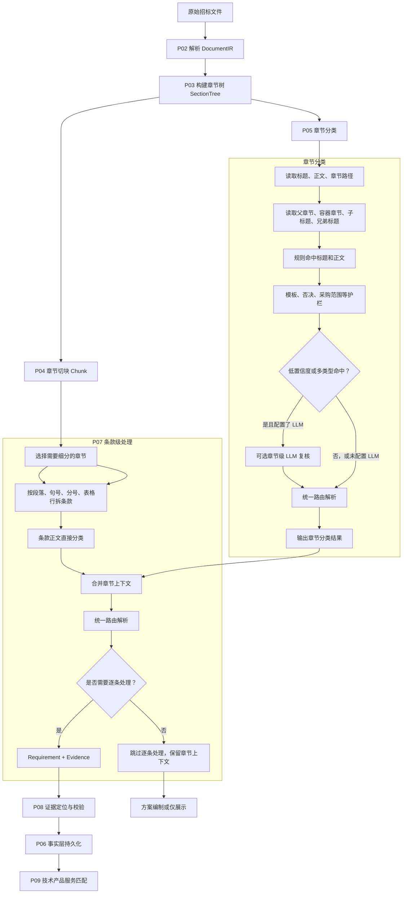
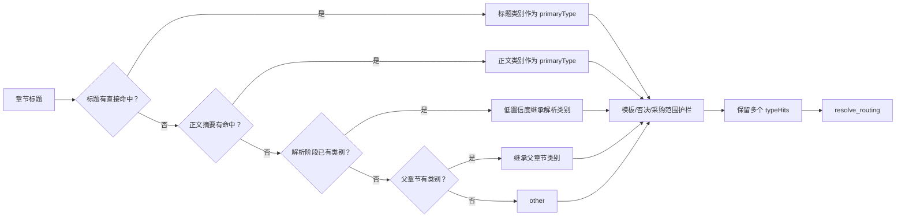

[TOC]

按**当前代码实际执行逻辑**，分类不是“一个章节只能一个类别”，而是：

- `primaryType`：最终主类别，只能一个
- `typeHits`：所有命中的类别，可以多个
- `primaryRoute`：后续由哪个流程处理
- `matchDomain`：如果进入企业库匹配，匹配技术、资质、业绩等哪一类
- `directTypeHits`：当前标题或正文直接命中
- `inheritedType`：来自父章节的上下文，不代表正文一定属于该类

## 一、总体流程图



当前实际执行顺序是：

```text
P02 解析
  ↓
P03 章节树
  ↓
P04 章节切块 + P05 章节分类
  ↓
P07 条款切分与条款分类
  ↓
P08 证据校验
  ↓
P06 事实持久化
  ↓
P09 企业能力匹配
```

代码位置：

- 章节分类：`backend/app/tender_matching/section_classifier.py`
- 路由解析：`backend/app/tender_matching/routing_contracts.py`
- 条款抽取：`backend/app/tender_matching/requirement_extractor.py`

## 二、章节分类逻辑

章节按以下顺序判断：



章节的主要规则：

1. 标题命中优先于正文。
2. 正文命中优先于父章节继承。
3. 父章节只提供上下文，不强行覆盖子章节。
4. 模板章节优先识别为 `document_format`。
5. 明确的废标、无效投标、否决章节优先识别为 `rejection`。
6. `scope` 章节保留为上下文，不整章进入企业匹配。
7. `service_plan` 章节默认是方案上下文，不整章进入企业匹配。

例如：

```json
{
  "heading": "第五章 招标内容及要求",
  "primaryType": "scope",
  "typeHits": ["scope", "technical"],
  "primaryRoute": "display_only",
  "matchDomain": "",
  "granularity": "section"
}
```

这里虽然同时命中 `scope` 和 `technical`，但章节本身是采购内容容器，所以不能整章拿去匹配企业能力。

## 三、条款分类逻辑

条款分类与章节分类不同，条款正文可以覆盖父章节类别。

条款判断顺序：

```text
1. 模板格式动作
2. 否决/无效/废标
3. 正文直接命中
4. 继承章节上下文
5. other
```

例如：

```text
章节：12. 售后服务
章节分类：service_plan
章节路由：writing_context

条款：平台必须支持上传场景文件和 GLTF 模型数据
条款直接命中：technical
继承章节：service_plan
最终主类：technical
最终路由：company_match
匹配领域：technical
次级路由：writing_context
```

输出类似：

```json
{
  "primaryType": "technical",
  "directTypeHits": ["technical"],
  "inheritedType": "service_plan",
  "typeHits": ["technical", "service_plan"],
  "primaryRoute": "company_match",
  "secondaryRoutes": ["writing_context"],
  "matchDomain": "technical",
  "granularity": "clause"
}
```

所以：

> 父章节不会决定所有子条款的最终分类。正文有明确技术信号时，条款分类会覆盖 `scope`、`service_plan`、`submission` 等宽泛上下文。

## 四、当前类别

当前内容类别主要有：

只针对这个方法，目前换一个新的思路：解析部分要不你就自己调用那个mcp呢，看有没有必要。

然后反过来，让agent直接读全文，目标就是找到对应章节或者所在的范围。（名字可能不一定完全对应）

1.技术部分（技术要求、服务要求，采购内容...）（后续进行匹配，前端展示）

2.资格审查（后续进行匹配，前端展示）

3.商务要求（后续直接展示在前端）

3.评分标准（后续直接展示在前端）

4.抢标成功后的合同部分（后续忽略）

5.模版部分（投标文件格式、响应表、模板）（后续将模版直接提取出来，供用户下载，也有通道给写标书的部分）

6.项目关键基础信息(后续直接在前端展示，例如什么最基本信息，还有采购范围、采购标的概览。报价、保证金、费用。 时间、交付、工期。投标须知、递交要求。是否接受联合体，电子标还是什么。等等，你可以先确立一个大致需要提炼的一般的关键信息（不用匹配，作为一项在前端展示）

7.废标项（ 废标、、无效、否决，不接受）（查找方式：全文正则）（不用匹配，作为一项在前端展示）

每一部分可以有个描述，那在寻找对应章节的时候就不容易找错什么的。


```text
！project_info       项目基本信息（scope     采购范围、采购标的概览。pricing  报价、保证金、费用。schedule            时间、交付、工期。submission         投标须知、递交要求
！evaluation          评标办法、评分标准。service_plan       实施、培训、运维、售后方案（评分标准，模版

！rejection           废标、无效、否决(分散)

！commercial         商务要求（固定）

！technical          技术、产品、功能、性能，（技术要求、服务要求，采购内容（固定）

！资格审查
qualification      资质、资格、证书（评分标准
performance        类似业绩（评分标准
personnel          人员要求（评分标准
financial          财务要求（资格审查

*document_format     投标文件格式、响应表、模板
*contract            合同条款（隐藏


**attachment          附件、附录
other               其他
```

## 五、路由不是分类

分类回答“这是什么”，路由回答“后面怎么处理”。

| 内容类别或情况                 | 主路由               |
| ------------------------------ | -------------------- |
| 技术要求                       | `company_match`      |
| 资质、业绩、人员、财务         | `company_match`      |
| 废标、无效、否决               | `rejection_check`    |
| 签字、盖章、承诺、合规响应     | `compliance_confirm` |
| 报价、质保期、交付期、商务响应 | `fill`               |
| 实施方案、培训方案、售后方案   | `writing_context`    |
| 项目概况、采购范围、评标说明   | `display_only`       |

`company_match` 再通过 `matchDomain` 区分：

```text
technical       技术产品服务
qualification   资质证书
performance     业绩
personnel       人员
financial       财务
credit          信用
region          地域
```

所以：

```text
evidence_match
```

不再作为前端独立标签，而是：

```json
{
  "primaryRoute": "company_match",
  "matchDomain": "qualification"
}
```

技术产品服务匹配则是：

```json
{
  "primaryRoute": "company_match",
  "matchDomain": "technical"
}
```

## 六、模板和技术同时命中怎么办

不会简单删除其中一个类别。

例如：

```text
技术和服务要求响应表
```

章节层：

```json
{
  "primaryType": "document_format",
  "typeHits": ["document_format", "technical"],
  "primaryRoute": "fill"
}
```

但表格里的真实技术行：

```text
平台必须支持三维场景加载
```

条款层：

```json
{
  "primaryType": "technical",
  "typeHits": ["technical"],
  "primaryRoute": "company_match",
  "matchDomain": "technical"
}
```

也就是说：

```text
模板章节本身 → 填写/商务响应
模板中的真实技术行 → 技术产品服务匹配
```

## 七、LLM 当前到底在哪里

当前代码已经预留了**章节级 LLM 复核接口**，触发条件包括：

```text
低置信度
多个分类同时命中
模板章节
否决信号
采购内容总览章节
无法归类为 other
```

章节级 LLM 输入：

```text
章节标题
章节路径
父章节类型
容器类型
子标题
兄弟标题
正文摘要
```

但当前真实评测中没有传入 `llm_classifier`，所以实际分类来源主要是：

```text
rule
content_rule
fallback
```

当前还有一个明确限制：

```text
条款级分类目前没有真正调用 LLM。
```

旧的 LLM 提取通道可以帮助抽取候选要求，但那不等同于条款分类 LLM。

## 八、最终判断规则

最重要的一点是：

```text
primaryType   = 内容主类别
typeHits      = 所有命中类别
primaryRoute  = 后续主处理流程
matchDomain   = 企业匹配领域
reviewMode    = 是否需要复核
```

前端最终应该主要看：

```text
primaryRoute
matchDomain
reviewMode
```

而不是只看：

```text
category
typeHits
usageTags
```

特别是 `scope` 章节，旧兼容字段里可能仍保留 `matching=true`，但前端必须以：

```text
primaryRoute == display_only
```

为准，不能把整章送进企业匹配。